# ADR-MEM-110: Native empty Owner Vault bootstrap

Date: 2026-10-30. Status: native implementation under synthetic validation and
Owner-contract review. This extends native admission; ADR93/103 business record
fields and the Owner layout do not change.

The owner explicitly authorized creation of an empty formal Vault in the
selected durable data home. This does not authorize importing inputs, models,
formation queues, Runtime adoption, old-root migration or Core-8 switching.

## Decision

Provide a separate `enouia-memory-owner-bootstrap` native local command in the
Host crate. It is an approved trusted native launcher/CLI path, never a callable
MCP/page tool. The embedding caller must not route untrusted packets into it.
The explicit `--bind-current-owner-self` scope registers the current authenticated
OS subject as this root's logical Owner, with Subject meaning that owner themself.
It cannot name another ActorRef, SID, PID or Subject. It does not bind a character
or infer identity from a person's name.

The native adapter obtains current process token SID/session evidence and retains
a live kernel process handle. These facts prove an OS account/session only;
same-account Agent processes can have the same facts. Owner registration also
depends on the already-authorized trusted native command invocation and explicit
self-binding scope. Neither flags, ACL, marker files nor a JSON fingerprint
independently authenticate a human or grant Owner authority. No new G08 Consent,
Windows Hello, password or external identity service is imposed by this ADR.

Issue fresh logical Owner/System/host/vault/self-Subject IDs through OsIdSource.
Random IDs are valid provisioning, not credentials. A private versioned binding
records the original operation, stable OS account reference, descriptor/hash,
controlled relative root, original home metadata and registration state. PID,
session ID and live handle are never serialized as recoverable capabilities.
Each invocation reauthenticates the current OS account and checks the protected
binding; missing, corrupt, foreign or synthetic bindings refuse. The descriptor
alone never recreates a missing Owner registration.

The private registration also binds the original verified canonical data-home
path. Compare the exact Unicode string returned by the existing Windows root
canonicalization (verbatim prefix removed), not a caller spelling or a lossy
string. Inputs that normalize to that same spelling are accepted; other spellings
fail closed rather than applying a second case-folding rule that could alias
case-sensitive Windows directories. Non-Unicode paths refuse. Copying either
pending or recorded registration to another home cannot create or claim a second
root with the same operation and identities. This locator is private and is not
included in the native result's authority fields or public documentation examples.

## Persistence and failure

The data home must be a verified durable local root, outside repositories and
temporary directories, with existing protected owner-only ACL and preservation
markers. Existing ACLs are checked, not weakened to enable creation. New private
bootstrap/root directories receive owner-only protection. Test enrollment exists
only under cfg(test); production rejects synthetic homes and test bindings.

Use a separate `.enouia-owner-bootstrap` area in the data home, not inside the
Vault directory that must initially be empty. One home bootstrap lease serializes
cooperating creators. Persist original IDs/operation/target and the metadata
baseline before any Vault write. A registration already exists: return it;
never silently allocate a different root or identity.

```mermaid
stateDiagram-v2
    [*] --> Registered: protected native enrollment
    Registered --> Creating: persist original creation intent
    Creating --> Verified: create, drop lease, reopen same binding and verify
    Verified --> Recorded: compare baseline and publish creation locator
    Creating --> Creating: query original root; explicit forward recovery only
    Verified --> Verified: conflict or unknown publication; retain operation
```



Reuse SegmentedAutomationVault::create and its witnessed descriptor genesis.
After releasing that writer, reopen with the same host binding and verify the
first genesis snapshot plus empty source/memory/policy/entity/conversation/Owner
action/job state. No business policy or formation journal is created for health.
Nonempty unknown directories are not overwritten or deleted. A healthy existing
genesis resolves the original result; incomplete CURRENT/witness needs explicit
`recover`, freshly authenticated and restricted to that original System binding.
Failure preserves directories and journal; it never blind-creates new IDs/paths.

Home metadata publication uses the home lease, original byte baseline rechecks
and atomic replacement. All cooperating metadata writers must honor that lease;
the operation does not claim an atomic transaction across journal, Vault and home
files or protection from a non-cooperating owner manually editing during rename.
Unknown metadata keys/values are retained. Conflicts retain the original creation
for reconciliation rather than overwriting another active root.

`active_vault` is a relative **verified creation locator**, not Runtime's selected
root or an automatic open instruction. `vault_creation.runtime_adopted=false` and
the locator semantics are explicit. Runtime retains explicit native root selection
and separately authorized compatible pin adoption. A recorded snapshot proves
empty state at creation; status does not claim the root is still empty later.

## Native commands

With the pinned Rust toolchain, the binary is built from package
`enouia-memory-host`; it takes only a selected home and, for commit/recovery,
the original operation ID:

```text
enouia-memory-owner-bootstrap prepare <OWNER_DATA_HOME> --bind-current-owner-self
enouia-memory-owner-bootstrap commit <OWNER_DATA_HOME> <OPERATION_ID> --bind-current-owner-self
enouia-memory-owner-bootstrap status <OWNER_DATA_HOME>
enouia-memory-owner-bootstrap recover <OWNER_DATA_HOME> <OPERATION_ID> --bind-current-owner-self
```

Prepare durably enrolls the original creation but creates no Vault. Native output
is private review data, not an admission token. Never publish real bindings,
account references, directory locations or outputs in Git. Real execution requires
the published tested adapter and actual native binding; synthetic fixture results
must not be relabelled as a production Vault.
