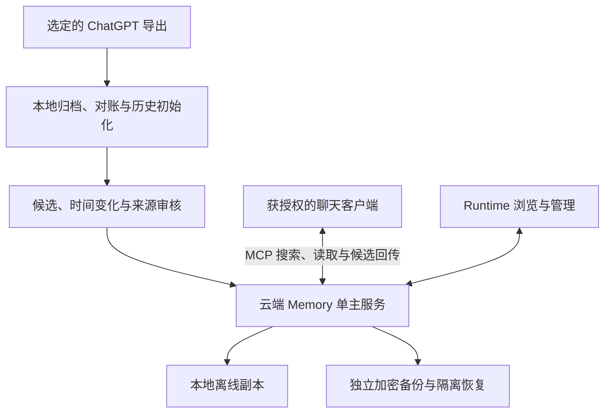

# 云端主库与历史初始化 · 设计包 v1.3

日期：2026-10-11。决策：[ADR-MEM-49](../adr/049-cloud-primary-and-history-initialization.md)。这是当前目标与后续工作包的规范；实现现状仍是本地 Core 和 MV-7 Provider。它不表示云服务、MCP 或完整历史提炼已实现。

Morii 在路线讨论中要求电脑关机后仍能访问完整记忆，随后要求沿该路线继续开发。本次据此修订方向，先完成 **MV-7-H1：离线历史初始化规划与合成样例**。MV-8 及后续阶段仍需逐阶段明确启动。真实导出、模型外发、云端迁移、服务器资源和上线均未激活。

## 1. 最终服务形态

云端 Memory 是单一权威写者，保存获授权的完整记忆库，独立完成检索、上下文编译、候选治理和会话记录。本地负责初始化、离线读取副本、独立加密备份与恢复；Runtime 负责浏览、审核和管理。云端运行和接口代码归本仓库，产品本地界面归 Runtime。

这里的云端不是仅接收事件的跳板，也不是只提供少量低敏资料的副本。云端可计算的内容在运行时必须对服务可见；传输及静态加密不能宣称服务器无法读取。真实启用前要由 Morii 选定服务信任、资料范围、密钥与恢复安排。对某个客户端的授权仍只覆盖所需项目、敏感级别和操作，不因主库完整便返回全库。

离线副本必须显示同步提交点和陈旧状态。云端不可达时本地可读，不偷偷恢复第二个 Canonical 写者；离线新增或纠正先留作待同步候选。永久删除、身份修改、关系约定与重大冲突继续由主人确认。低风险自动接受的内容类型和可撤回授权策略尚待 Morii 决定；当前仍全部进入审核。

## 2. 历史初始化的四种成果

| 成果 | 保存什么 | 依据与限制 |
|---|---|---|
| 原始档案 | 实际收到的字节、会话树、编辑分支、时间和附件 | 原件哈希及来源 locator；收到完整包不等于平台历史完整 |
| 经历与变化时间线 | 事件、决定、计划、纠正和取消 | 每项回到原文；消息时间不自动等于事实生效时间 |
| 当前长期记忆 | 经审核的偏好、事实、项目状态、身份约定 | 来源、valid time、known time、替代链；最近一句话不自动获胜 |
| 主题回顾 | 按主题、项目、时期形成的导航 | 派生摘要，注明覆盖范围并关联原文；不能充当唯一证据 |

先归档和对账，再规划批次、提炼候选、跨时间比较、审核和生成回顾。跨时间关联以可核验的实体/项目关系为依据，不能只因标题或名字相似便合并。没有证据时保留未知，遗漏可以回到原文补提炼。

### MV-7-H1 已实现的规划边界

`enouia-memory-import::history::plan_history` 使用现有 adapter 的 `ParsedInput`，只返回内存中的处理计划，不读凭据、不访问网络、不提交记忆。保留配对的输入原件，`MessageRef` 仅在这份解析结果中有效，不是跨导出稳定 ID，也不是存储或 MCP 新契约。

- 全部已解析消息各一次进入已知时间导航或未知时间列表；另列无法解析数、部分内容和不可用附件。时间范围只是观测范围，没有“三年全覆盖”的通过标志。
- 每个会话的根到叶路径分别分批，共用祖先只重复引用，不复制导入来源。批次按路径最早已知时间排序，路径内按父子关系；全局时间导航单独按时间排序。时钟倒退报告问题，不改写消息时间。
- `current_node` 只表示导出选择的分支，不是事实批准。缺少或无效选择不会猜主分支。重复消息 ID、缺失父链或环保留覆盖信息，但不给该会话安排提炼批次。
- 单批最多 256 条消息，总路径引用有明确上限；共享祖先也计入。超过上限返回错误，不交付悄悄截断的计划。相邻批次保留上一条消息引用，后续处理仍须单独控制原文长度、上下文和 token 预算。
- speaker、evidence、locator、content hash 和原始时间沿用 adapter；助手提议仍是 model_claim。导出中的“自动批准”只是源文。

运行内置合成样例：`cargo run -p enouia-memory-import --example plan_history --locked`。输入固定为仓库合成 fixture，没有真实文件参数。这个样例验证规划、可追溯性和缺口报告，不验证模型理解、跨时期自动合并、主题回顾质量或三年规模性能。

### H2：下一次领取的初始化工作包

**2026-10-12，H2a 已实现：** [ADR-MEM-50](../adr/050-archived-history-extraction-batches.md) 把明确选定的 H1 批次绑定到已归档原件、adapter 和当前来源修订。`history::materialize` 保存带来源依赖的协调计划，并复用现有抽取 Session/job；取消、发布失败或重启后用原始 key/options 找回同一批任务。进度从子任务游标和实际调用结果重建，没有独立旁路数据库或自动发送器。单次最多选择 32 批，每批 1～15 条消息及一条前文；既有片段/任务字节限额和 128 KiB 计划元数据上限仍须满足。[验证报告](../validation/MV-7-history-binding.md) 区分了恢复证据与语义质量。

在已归档且校验通过的来源上，把规划中的片段绑定到现有 MV-7 抽取任务。保存 `input hash + adapter version + plan version + source revisions + cursor`，中断/重试复用任务收据，不重复外发。模型预算按精确文本和 Provider 能力控制，不能以“32 条消息”代替 token 上限。

后续 H2 还需输出新增、重复、纠正、取消、冲突等建议及其证据；跨分支信息不自动解释为时间上的替代。事实生效时间和消息时间分开，无法确定的时间不补猜。处理过的批次与抽取质量分别报告；“已处理”不等于“重要内容无遗漏”。H2a 只证明来源绑定与现有子任务的恢复，不实现跨批语义判断或主题回顾。

先用合成问题评估：过去偏好与当前偏好、计划与取消、用户决定与未采纳助手建议、分支冲突、无日期与缺证据。批准后才进入正式记忆。真实历史的小样本由 Morii 选择，在备份和恢复门槛满足后另行启用；不自动查找私人缓存。

## 3. MCP 的回忆与记录循环

最小工具继续采用 `memory_search`、`memory_read`、`memory_source`、`context_get`、`memory_propose`、`session_checkpoint`，权限沿现有语义拆分。回答前先搜索，需要时读取有界来源；出现新长期信息后回传带来源的候选，服务检查重复、时效、冲突和范围，再进入审核。未知来源的客户端提交保持 `agent_submission / partial`，不能伪装用户原话。

MCP 工具可由模型选择调用，但是否调用取决于客户端和模型；协议不会自动交付整段第三方聊天。[工具规范](https://modelcontextprotocol.io/specification/2025-11-25/server/tools) 说明这种调用模式。客户端接入要记录具体版本、传输、权限和结果大小；远程认证按实施时锁定的[官方认证规范](https://modelcontextprotocol.io/specification/2025-11-25/basic/authorization)验证。本文不指定尚未验证的客户端兼容性或 SDK。

普通客户端不获得 `candidate_review`、Identity 批准和 purge 工具。删除和授权撤回在检索返回与 Provider 发送前复核最新屏障，旧 capsule 不能绕过撤回。去重和合并只是候选整理；模型 confidence、重复次数或被召回频率不授予批准权。

遗忘优先表现为临时有效期结束、归档或退出默认回忆。重要经历不能因长期未召回自动删除。彻底删除继续走 owner 的影响预览、精确确认与删除回执，并记录本地副本、云端、备份和外部模型中可控与不可控的范围。

## 4. 单主迁移与恢复

MV-8 先把 Core 与平台存储/凭据分开，验证云端需要的文件系统、锁、持久化和密钥端口；当前 Windows NTFS/ACL 根检查不能直接假装支持 Linux。内存或临时目录测试不证明 VPS 存储可靠性。

真实切换前停本地写入，固定提交并验证全量来源、审核、删除台账和策略，在独立位置完成加密恢复。云端导入该快照后验证相同提交内容，再经主人确认提升 `primary_epoch`；旧主必须被栅栏拒绝写入，本地转只读。切换失败时保持原主或受限恢复状态，不能让两端分别当主。故障回退须先停止旧云写者、核对最后提交与撤回水位，不回滚删除记录。

这只是迁移要求，尚未增加 `primary_epoch` 的机器字段或协议。具体契约在 MV-8.1 冻结并用合成测试证明后采用；现有 Vault 格式和 workspace IPC v1 继续运行。

## 5. 更新后的阶段与 v1 出口

| 阶段/工作包 | 交付与出口 | 当前范围 |
|---|---|---|
| MV-7-H1 | 方向对齐、来源/时间/分支规划和合成样例 | 本次实现；不以此宣布 MV-7 完成 |
| MV-7-H2 | 可恢复批量初始化、跨时间候选与回顾质量样例 | H2a 来源绑定/子任务恢复已实现；跨批语义与回顾质量待做；真实模型及个人材料另行启用 |
| MV-7 原出口 | 双 Provider 真实受控验收、Runtime 对话闭环 | 仍未完成，不用 H1 代替 |
| MV-8.1 | 单 Host、平台端口、主权与迁移契约；合成故障验证 | 下一阶段须明确启动 |
| MV-8.2～8.4 | 本地/云端复用的 MCP 适配；认证、范围、单客户端闭环 | 先 fake，再按选择的客户端验收 |
| MV-9 | VPS 云端权威服务、独立备份、连续运行与受控切换 | 不再仅网关队列；真实资源另行启用 |
| MV-10 | 本地副本与离线候选同步、设备撤回、恢复和迁主 | 无双主，删除与策略优先 |
| MV-11 | 根据样例暴露的漏召回改进检索/整理 | 不以复杂图谱替代先验闭环 |

v1 必须证明：已收到历史的原件可对账并恢复；批准记忆能区分过去/现在和来源；一个获授权 MCP 客户端走通“回忆→回答→候选→审核→下次使用”；Runtime 能管理同一主库；电脑关闭期间云端仍可读写获准内容；取消、重启、凭据撤回、主机故障与独立恢复留下明确证据。三年全量处理的成本、质量和审核负担需由样例测量后确定，不能先给百分比或工期。

云服务信任及实际资料范围、首个客户端、备份位置/恢复秘密、真实历史和模型预算、低风险自动接受策略仍需 Morii 在对应激活点决定。它们不阻止本次纯合成规划，也不由本次“继续开发”自动填入。
