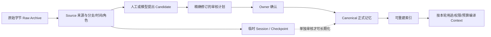

# 当前记忆核心：已有什么，缺在哪里

> 历史材料（2026-10-24，2026-11-02 补入版本管理）。实现状态、暂停与授权只描述原日期；当前事实以主线实现、分阶段计划及最新验证报告为准。本文不启动任何工作。

核查日期：2026-10-24（Asia/Shanghai）。实现基线：`9286cd8f89669d9ec3b92f943fd74072457536e7`。这是对当前源码、契约、ADR 与已保存验证报告的只读审计；没有打开个人 Vault、运行模型或重跑测试，也没有更新手工项目状态。

## 先回答 Morii 的两个问题

**已经做到 MCP 这一层，但还不能说“真实 MCP 接入已经完成”。** 当前 MV-8.2e 已实现受限 stdio MCP 协议，以及同一个 Host 内六个工具的领域绑定：搜索、读记忆、读来源、编译有限上下文、提交待审候选、保存临时 checkpoint。当前仍缺外部 Agent 的原生认证/登记与可运行接线、实际 MCP 客户端验证、安装和个人验收；`context_get` 也只开放当前提交、无会话/分支、固定离线目的地的子集。见 [MCP 出口表](../../validation/MV-8-host-agent-checkpoints.md#exit-table)、[ADR-MEM-80](../../adr/080-restricted-mcp-stdio-boundary.md)、[ADR-MEM-83](../../adr/089-host-agent-local-context.md)。

**本地工程底座已相当完整，记忆认知逻辑还远未“做完”。** 现有强项是保真归档、来源追踪、明确审核、版本/冲突、权限/删除、确定性检索和上下文接续。它更接近“可追溯、可审核的长期记忆库”，还不是会持续观察生活、跨事件形成理解、适时想起往事、随时间自然淡出的完整记忆系统。把工程可靠性和记忆质量拆开，才能解释为何代码已经推进到 Host/MCP，使用感仍像基础信息提取。

## 1. 现在一条记忆怎样形成



1. **先保全，再解释。** 导入按真实字节哈希保存 Raw，再解析 Source。Source 记载原始消息/会话标识、父来源、分支、定位器、发生时间、捕获时间、说话角色、证据类别、完整度和附件。相同来源命名空间与消息 ID 对账，内容变化保留修订，不把每次导出当成全新事实。[`import_file` / `build_unit`](../../../crates/enouia-memory-import/src/pipeline.rs#L294)；[实际 Source 字段构造](../../../crates/enouia-memory-import/src/pipeline.rs#L664)；[`SourceRecord`](../../../crates/enouia-memory-contract/src/source.rs#L75)。
2. **生成的是候选。** 用户手动陈述、Agent 建议、可选模型抽取都经过治理。证据类别从被引用的 Source 修订读取，提议者不能把助手的话标成用户确认。Agent 所声称的“用户同意”只是数据。[`evidence::resolve`](../../../crates/enouia-memory-govern/src/evidence.rs#L54)；[`AgentSubmission`](../../../crates/enouia-memory-contract/src/source.rs#L63)。
3. **当前通用模型抽取很窄。** `extract-text-2` 的响应只接受 `fact` 与 `preference`，要求确切引文；偏好必须有实际用户证据，结果写 `epistemic_status=uncertain`，先进入待审队列。引文包含检查证明“这段话存在”，不证明模型对否定、隐喻、角色扮演或语境的理解正确。[`Claim` 与 `proposals`](../../../crates/enouia-memory-provider/src/extraction.rs#L526)。
4. **长期化由明确审核完成。** `review::plan` 展示精确变更并绑定修订、差异哈希、主人与可信入口；`confirm` 再检查确认匹配、过期、当前差异和回执，然后事务提交正式记录。模型置信度、重复次数或被调用次数均不提供批准权。[`plan`](../../../crates/enouia-memory-govern/src/review.rs#L1058)；[`confirm`](../../../crates/enouia-memory-govern/src/review.rs#L1120)。
5. **跨时间理解已有一些工具。** 历史任务支持按主题比较、已选来源父链、新信息/纠正/取消/冲突/不确定的语义建议、确切引文、主人选择的草案和待审发布；纠正不靠“最近一句”自动获胜。它们仍以选定范围和人工审核为中心，不是自动全库巩固器。[`history_semantic::TASK`](../../../crates/enouia-memory-provider/src/history_semantic.rs#L40)；[`draft`](../../../crates/enouia-memory-provider/src/history_semantic_proposal.rs#L81)。

“导出已收到”“Vault 已创建”“来源已导入”“候选已提取”“已审核长期记忆”“长期质量已验收”是六种不同成果。本轮没有读取真实库，不能从代码推断 Morii 当前 Canonical 数量或审核完成度。初始化维度是否充足，需要之后对明确选定的私有样本做覆盖与漏提审核；不能靠再跑一遍摘要宣布完成。

## 2. 长期记忆目前能表达什么

[`CanonicalMemory`](../../../crates/enouia-memory-contract/src/memory.rs#L189) 已有比“正文摘要”丰富的基础字段，但字段存在不等于初始化流程已填好。

| 层次 | 当前字段/类型 | 实际边界 |
| --- | --- | --- |
| 基本类型 | `fact`、`preference`、`episode`、`project_state`、`session_checkpoint` | 领域契约有五类；通用模型抽取只覆盖前两类 |
| 人物与主题 | `subject_ids`、`project_id`、`category`、`tags` | 尚非通用实体注册表、关系本体或语义事件图 |
| 经历 | 发生起止、时间精度、参与者、摘要 | 类型可表达，未见自动经历发现/合并/阶段聚合流水线 |
| 项目 | planned/decided/implemented/tested/released/unknown，决定与未完成事项分开 | 能防止“计划”被误当作“已完成”，适合保留 |
| 时间 | valid_from/until、observed_at、last_verified_at、review_after、volatility | 主要解决适用期与当前性，未实现认知衰减 |
| 知识状态 | asserted/corroborated/uncertain/disputed、confidence、冲突组 | confidence 是提示，不能代替证据或安全判断 |
| 版本与来源 | memory/revision、evidence、context_source_refs、supersedes、review/approved 信息 | 支持证据与模型看过的上下文依赖分开，删除影响须同时覆盖 |
| 权限 | sensitivity、access_policy_id、egress_policy_id | 外发默认不因记忆已批准而获准 |

尤其值得注意：[`new_memory`](../../../crates/enouia-memory-govern/src/review.rs#L339) 的缺省是空人物/项目/分类/标签、空有效期与复核日期、`volatility=stable`、`priority=P2`，调用方提供 details 才覆盖。普通抽取只补 subject、claim_key 或 preference scope 等有限维度。**维度薄既来自抽取范围窄，也来自缺省值和缺少逐维覆盖验收**；并不证明已有真实记录都缺这些字段。

尚缺的高价值表达包括：事件的原因/结果与转折、目标与承诺的生命周期、关系随时间的变化、明确的否定/假设/角色扮演语境、本人解释的意义、可选且来源清楚的情感体验，以及“何时适合被唤起”的上下文线索。以上应该作为新的设计和候选维度，不能从现有字段反向假定已经具备。

## 3. 现在什么时候会想起一条记忆

当前由调用驱动：用户/客户端提交 query，搜索器找出正式记忆，Context Compiler 按本轮用途和预算装配。这里的“自动”是查询发生后的选择，不是后台主动想起，也不是自动向 Morii 发起对话。

### 实际召回和排序，不能套用参考项目的权重

当前索引是 SQLite 的可重建投影，包含 trigram 与 unicode61 FTS。查询先做 Unicode/大小写折叠、按空白拆词；三个及以上字符走 trigram，短词走有界字面子串，ASCII 词另有整词匹配，项目名/别名精确命中可召回同项目记忆。[`text_rows`](../../../crates/enouia-memory-index/src/search.rs#L315)；[`fold::terms`](../../../crates/enouia-memory-index/src/fold.rs#L22)；[索引结构](../../../crates/enouia-memory-index/src/store.rs#L43)。它不是现成的语义向量或神经联想系统。

先执行类型、项目、当前 tombstone、来源闭合、当前权限、有效时间过滤，再排序。`rank-1` 的真实升序字典键是：

```text
K_index = (
  非精确项目命中,
  当前性序号,
  非 ASCII 整词命中,
  文本通路名次,
  priority 序号,
  业务相关日期倒序,
  memory_id,
  revision
)
```

其中当前性依次是 `current_supported=0`、`needs_reverification=1`、`conflicted=2`、`historical_only=3`；priority 是 P0/P1/P2；日期依次回退 `valid_from → observed_at → created_at`。文本通路名次内部用 FTS `bm25`，缺省为最大名次。**没有 `topic×4 + emotion×2 + time×1.5 + importance×1` 一类加权和，没有情绪项、使用频次项或指数衰减项。** 证据数量会返回给调用者，但没有进入这个排序键。[完整键](../../../crates/enouia-memory-index/src/search.rs#L573)；[枚举顺序](../../../crates/enouia-memory-index/src/search.rs#L297)。

Context Compiler 的 `context-rank-1` 再对已经召回的记录按 `(没有直接用户证据, index 名次, memory_id)` 排序；直接用户证据是一个布尔优先项，并不是逐命题语义证据强度测量。[实际代码](../../../crates/enouia-memory-context/src/compiler.rs#L571)。注意旧设计 [CONTEXT_MODEL §4](../CONTEXT_MODEL.md#4-确定性排序基线) 的文字概括与具体键并非逐项相同；后续调整排序时应同时冻结实现、文档和离线 golden，而不能把旧文字或参考项目数值当作当前算法。

编译器保留权限/来源硬约束，冲突按组整组装配，缺一侧权限或预算不足时不会凭高分只装一侧；输出需复核、无支持证据或预算不足等元数据。长期记忆预算上限取剩余容量和 4096 中的较小者，当前离线计数版本是 `mock-utf8-1`，不是所有真实模型的精确 tokenizer。[组装与来源检查](../../../crates/enouia-memory-context/src/compiler.rs#L689)；[预算](../../../crates/enouia-memory-context/src/compiler.rs#L472)。

### 目前没有的唤起能力

当前源码中未见独立的语境触发器、周年/未竟事项触发、主动回顾队列、跨事件联想扩散、基于用户反馈校准的召回质量循环。搜索日志也不能直接成为“这条记忆很重要/很真实”的强化依据。未来主动性需要设计触发条件、安静时段、去重、过敏感筛选、理由解释和一键暂停；这些是待开发能力。

## 4. 现在怎样遗忘、纠正与保留过去

目前的“遗忘”是明确的治理与时效规则：

- **到期或被替代**：`valid_until` 到期和已经生效的 `supersedes` 使记录成为历史；默认当前检索不包含历史项，但显式历史查询仍可取回。未来才生效的替代不提前遮掉现在仍有效的旧事实。
- **未知替代时间**：保留未知，不拿审核日、导入日或消息日期补作业务生效时间；两侧保持需复核。`review_after` 到期或 `volatility=live` 使当前问题标需复核，不自动删除。
- **归档**：退出默认可用集合。
- **逻辑删除**：owner 精确确认后建立 tombstone，阻断检索与外发，当前删除屏障也约束历史快照。
- **彻底删除**：先看依赖影响，再确认 purge、清理被命名字节并保存删除回执。上下文/candidate/checkpoint 等依赖和备份/外部系统的未完成范围须如实保留。

依据：[`temporal::effect/currency`](../../../crates/enouia-memory-contract/src/temporal.rs#L32)、[`delete` 的两种模式](../../../crates/enouia-memory-govern/src/delete.rs#L1)、[`purge_preview`](../../../crates/enouia-memory-govern/src/delete.rs#L431)、[`complete_purge`](../../../crates/enouia-memory-govern/src/delete.rs#L534)。

**未见“时间久了就衰减、反复想起就强化、低于阈值自动忘记”的生产逻辑。** 已有路线也明确重要经历不能因长期未召回自动删除。[现有遗忘方向](../CLOUD_PRIMARY_AND_HISTORY.md#3-mcp-的回忆与记录循环)将淡出默认回忆与永久删除分开。后续可加入可恢复的注意力/可访问度模型；存储保留、真实性、当前性、情感重要性和召回概率应是独立量。

## 5. 已有优势与真实缺口矩阵

| 能力 | 实现/合成证据 | 真实接入与个人验收 | 主要缺口 |
| --- | --- | --- | --- |
| 字节归档、来源定位、父链、未知时间 | 已有 importer/契约 | 本轮未查个人库 | 附件与语义覆盖仍须按实际输入对账 |
| 人工长期化、编辑/合并/替代/冲突 | 已有治理实现 | 本轮未核实实际审核完成度 | 降低审核负担且保留精确确认 |
| 去重 | 去空白正文+类型/details/目标的 fingerprint；提取对已审核且证据未变的同命题抑制重开 | 无真实质量结论 | 同义改写去重、合并建议、语义范围校准 |
| 冲突识别 | create 的 fact claim_key / preference scope + 共享主体 + 不同正文 | 非通用逻辑推理 | 不同措辞、含条件/时间的等价与冲突判断 |
| 跨时间历史审核 | 主题、直接父链、纠正/取消/冲突建议、引用/草案/待审发布 | 真实模型忠实性与漏提未完成 | richer episode/project/relationship 提炼和重要单元覆盖 |
| 搜索/Context | 确定性 FTS、当前性、权限、整组冲突和预算 | 不等于真实对话效用 | 语义召回、查询改写、质量反馈与可复现比较 |
| Session/Checkpoint | 原始事件、分支、覆盖 hash、provisional 及来源身份 | MCP 真实客户端未完成 | 临时上下文到长期结构的明确巩固路线 |
| 受限 MCP | 协议+六工具同 Host 的合成领域绑定 | 外部认证/运行接线、真实客户端、安装、owner 接受待做 | 真正日常闭环与更广 Context |
| 主动唤起 | 未见专门实现 | 无 | 上下文/时间/目标触发与抑制、反馈 |
| 自然淡出 | 有到期/归档/需复核；无认知衰减 | 无 | 可恢复注意力与复习机制 |
| 星图/事件平行轴/记忆格 | 基础元数据可供投影 | 无该类产品验收 | 通用关联模型、聚合读取契约、Runtime UI |
| 情绪/意义/关系演变 | 没有通用生产字段或计算管线 | 无 | 可选表达、证据和敏感授权，避免推断定性 |

去重和冲突的准确范围见 [`fingerprint`](../../../crates/enouia-memory-govern/src/propose.rs#L145)、[`conflicts`](../../../crates/enouia-memory-govern/src/propose.rs#L234)、[`propose_extracted`](../../../crates/enouia-memory-govern/src/propose.rs#L603)。来源父链是“这条消息来自哪个分支”的证据图；`supersedes`/冲突组是治理图；二者都不能直接冒充“人生意义/关系/事件”语义星图。

## 6. 优化与迁移必须保留的东西

1. **保留现有存储、来源、审核、权限与版本链。** 参考项目可以提供联想、衰减、事件和 UI 经验，不能用新的单一 score 覆盖既有 Canonical 或 Raw。索引/布局/聚类可重建；被批准的事实和审核不能从新聚类结果自动重建。
2. **把新认知逻辑接在候选与派生视图层。** 将情境、事件、意义、关系、目标等提取为带来源、未知值和版本的建议；派生关联可供探索，升级成正式事实仍须现有审核。优先利用当前元数据做只读投影，避免为了画图先改写真实历史。
3. **区分两种长期化。** 工程上的 Canonical admission 已有；跨多次经历抽取稳定偏好、纠正旧假设、合并事件、形成主题的“巩固”仍需设计。可以减少对重复且低风险候选的重复审核，但不得让召回频次或模型自述成为批准依据。
4. **旧记录只做显式 enrichment 计划。** 回填新维度须列出来源、拟写字段、未知/冲突、敏感影响和差异；没有证据的维度为空。不得因字段缺失重新导入原始字节或批量重写已批准内容。
5. **排序/衰减先离线比较。** 保留 rank-1 为基线，加入语义召回或 salience 时固定算法版本、解释分解、时间重放和回归样本；对照新旧命中、无关唤起、遗忘误伤与用户修正，不用漂亮模拟动画代替质量证据。
6. **UI 在 Runtime，Core 保持 transport-neutral。** 本仓库提供契约和领域投影；Runtime 决定渲染与交互。新 contract/Workspace 接口须同提交更新集成面和 Runtime 采用说明。不要为追最新 Memory HEAD 强迫 Runtime 立即切 Host。
7. **沿用云端单主路线。** ADR-MEM-49 已明确云端主库目标；本地初始化/离线副本/恢复是支持角色。当前只是本地实现与 Host 单主契约，不是云服务已上线。新增认知逻辑应运行在选定主库，避免 Runtime、MCP 和后台巩固器各自成为写者。[云端方向](../../adr/049-cloud-primary-and-history-initialization.md)、[共享 CURRENT](../../adr/068-shared-current-authority-publication.md)、[发布/恢复](../../adr/073-host-publication-recovery.md)。

## 7. 本报告的证据限度

本轮执行的是源码/文档读取、符号和缺项搜索、当前 Git HEAD/工作区只读核对、本文格式检查；没有 tests、build、schema checker、Runtime surface checker、真实模型调用、真实 MCP 客户端或私人资料检查。

已保存的 [MV-8.2e 报告](../../validation/MV-8-host-agent-checkpoints.md#checks-actually-run)记录 Host 61 + Context 15 项合成检查通过及相应静态检查；这是该实现片的历史证据，不是本轮重跑。[真实双 Provider 手册](../../validation/MV-7-real-smoke.md)状态仍为待执行、执行记录尚未执行；[质量评估](../../validation/MV-7-quality-assessment.md)与[语义校准](../../validation/MV-7-semantic-calibration.md)证明审核工具/预设题计算，不证明真实模型质量、全量覆盖或主人验收。[参考壳收口](../../validation/MV-8-reference-shell-host-closeout.md)也明确 Runtime 已有 embedded Memory 产品集成，而 native Host 采用仍须单独处理。

因此可以确认“有一个扎实而受限的本地记忆工程底座，已经实现 MCP 合成绑定”，不能确认“完整记忆逻辑、真实 MCP 日用和初始化质量都已完成”。下一步最有价值的工作是补齐有证据的多维记忆与巩固/唤起/淡出逻辑，并让这些过程在 Runtime 中可看、可解释、可纠正。
