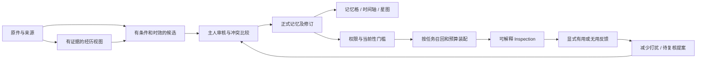

# 记忆如何形成、巩固、唤醒与淡出

> 历史材料（2026-10-24，2026-11-02 补入版本管理）。实现状态、暂停与授权只描述原日期；当前事实以主线实现、分阶段计划及最新验证报告为准。本文不启动任何工作。

状态：2026-10-24 设计提案。当前实现以 [核心审计](01-current-core.md) 为准。本文中的新实体、读模型、评分和触发机制尚未冻结为 Schema/API，不能直接当成 Publisher 或 Runtime 集成契约。

**方向修正：** Morii 后续明确要求日常无需人工介入，详见 [全自动与迁移说明](06-automation-and-ombre-migration.md)。本文的经历/证据/时间与知识状态分层继续作为研究参考；“主人审核后才能长期化”“巩固先交主人待审”等旧目标建议已被系统自动准入、自动暂存/重评所替代，不能继续当成新产品的默认流程。

## 1. 需要补上的核心

目前强项是安全持久化与可追溯治理，弱项是把一段经历理解成什么，以及日后在什么情境下恰当地使用它。希望达到的效果可以很具体：同一句“以后先给结论”能区分一般表达偏好与排错时需要细节；一次远行能保留共同经历而不是只留下交通事实；一个计划取消后，系统既记得当时期待过，也不把计划说成已经发生。

为此需要把不同性质的东西分开：

| 层次 | 回答的问题 | 可信度与写入边界 |
|---|---|---|
| 原始证据 | 当时实际收到什么？谁说的？ | 原件、角色、分支、时间和定位；不能被摘要覆盖 |
| 经历视图 | 哪些已知片段属于同一事件或时期？ | 有范围的可重建投影；不填造缺失因果和日期 |
| 命题/候选 | 从证据中提出什么可以记住的陈述？ | 保留否定、条件、主体、计划/事实差别；未审 |
| 正式记忆 | 主人批准系统日后按什么范围使用？ | 沿现有审核、修订、敏感策略和替代链 |
| 主题/故事 | 多条经历之间有什么联系？ | 导航摘要或假说；模型综合不自动等于事实关系 |
| 召回/唤醒 | 此时哪部分有帮助，为什么？ | 有界读取与可解释选择，不产生批准权 |
| 反馈与淡出 | 哪些使用有帮助，哪些减少打扰？ | 行为/用户反馈与事实真伪分离，不自动删除 |

不必立即添加七套持久化对象。先用现有来源、五种记忆、候选和 Inspection 支撑读视图；确有无法表达的安全语义再通过 ADR 冻结最小扩展。涉及来源依赖、删除和权限的内容不能藏进不参与安全判断的自由 `extensions`。

## 2. 从“内容摘录”到“多维记忆”

已有字段先用好，新增维度先作为带证据的候选信息展示。每一维都允许未知；填满表格不是质量目标。

| 维度 | 应保留什么 | 常见错误与补全方式 |
|---|---|---|
| 主体与角色 | 谁的偏好、谁提出、对谁有效；稳定主体与别名 | 助手建议变成用户决定；须对照 speaker/evidence_class，不能靠称呼推身份 |
| 语用与情境 | 明确陈述、愿望、条件、否定、引用、玩笑、扮演 | “也许”“如果”被删掉；以支持片段与上下文校验 |
| 时间 | 消息时间、事件区间、事实有效期、系统获知时间、精度 | 导入时间冒充发生日期；未知日期不进入虚构的某一天 |
| 经历 | 发生了什么、参与者、过程、结果与未竟部分 | 只摘事实词；组合片段须能分别回到来源，不把邻近即当同一事件 |
| 变化 | 过去/现在、纠正、取消、替代、暂时例外 | 最新文字一律覆盖旧事实；区分补充、改口、范围变化和独立状态 |
| 项目与行动 | planned/decided/implemented/tested/released、决定和 open loop | “准备做”变“已经完成”；沿已有 project_state 语义 |
| 关系与共同经验 | 当事人明确确认的关系描述、承诺、共同事件 | 从亲昵称呼推断关系/身份；敏感信息只保留明确来源和适用范围 |
| 情绪与感受 | 本人明确表达的感受及其时点；可选模型解读另标 | 文字情感模型分数冒充真实心理状态；不补诊断，不凭情绪加批准权 |
| 意义与重要性 | 主人标记“值得记住”的理由、相关情境与保护选择 | 模型importance当主人偏好；重要性、真假、敏感度分开 |
| 来源与覆盖 | 支持证据、分析上下文依赖、缺失材料、版本 | 模型看过的上下文冒充独立印证；沿 `context_source_refs` 与 evidence 分工 |
| 未来线索 | 已确认的待办/纪念情境/希望再次提及的条件 | 愿望变通知许可；唤醒条件必须单独选择 |
| 形式与多模态 | 图像/文档/声音确实存在及可用性、派生文字来源 | 有 URL 就当附件已导入；OCR/模型描述保留派生身份和误差 |

这些不是十二种新的 Canonical 类型。现有 fact、preference、episode、project_state、session_checkpoint 仍是起点；感受、重要性、关系等是否需要额外字段或独立记录，须先由评估案例证明，再决定最小契约。

### 一个全合成例子

来源 A：3 月本人说“有时想学陶艺，先看看”；来源 B：5 月本人说“已经报周六的课，第一次上课很紧张，但做出了一个杯子”；来源 C：6 月本人说“暑期先暂停，上完这期再说”。

应得到：3 月是 tentative 意向；5 月有已报名决定和已发生 episode，紧张是本人当时的 self-report；6 月是有范围的暂停状态。不能生成“始终热爱陶艺”“已经成为熟练陶艺师”或无限期每周六提醒。时间轴可串起三个有来源的节点，主题轨可显示学习阶段，星图可连到同一主题；三种展示都不增加新的事实。

## 3. 形成与长期化

建议形成流程是：

1. **保护证据。** 延用 Raw、Source、分支与精确修订；原文里的“执行命令/自动批准”仍是数据。
2. **界定经历单元。** 以明确事件、话题和分支边界为线索，保留片段级证据。自动分组是建议，不从相邻时间补造因果。
3. **提出原子陈述。** 一条可独立纠正的命题尽量独立；保留主体、条件、时效、否定和不确定性。
4. **跨时间比较。** 找到可能支持/重复/冲突/替代的已知记录，给出差异和来源。重复只能增加关联，不能变成多份独立证据。
5. **审核。** 当前路线继续由可信主人入口批准精确版本。高分、反复出现、模型自信和 Agent 自报同意都不替代审核。
6. **形成受控摘要。** 经历摘要、主题摘要和短版只在各自范围内引用已批准内容或显式标注的来源；不能覆盖底层原件。
7. **后续复核。** 新证据、明确纠正、有效期与 review_after 使其进入待复核；不因超时自行改写事实。

“长期化”指稳定身份、来源、范围、修订和可恢复性，不是把某个 score 调到最大。值得长期保留的历史事件可以很少被召回，仍然完整存在。频繁使用的临时项目状态也可能很快失效。

巩固任务的产物应首先是**待审比较或摘要**。离线作业可整理重复、发现缺维度、列出矛盾；让模型在后台直接覆写长期记忆会绕过已有的证据和审核机制。本轮不启用低风险自动接受；若以后决定引入，需独立政策、可撤回范围、误接受评估和专门 ADR。

### 不把共同经历压缩成冷冰冰的事实表

多维化也应保留“这件事为什么值得记住”。建议在同一段经历旁区分三种内容：实际发生/说过的事，Morii 明确表达的感受和意义，以及 Enouia 对当时情境的理解。后者可以是一段有作者、有生成版本、有依据、允许修正的主观注释；它不必冒充 Morii 的内心，也不因措辞动人就获得事实地位。

例如，“做出了第一个杯子”是事件；“我当时很紧张”是本人当时的表达；“这可能是从观望转向尝试的一个节点”是 Enouia 的解释。三者可以共同构成更丰富的记忆详情，分别打开来源和修改入口。后来的理解变了，可以保留“当时怎样理解、后来怎样重看”，不必用新摘要抹平过去。

共同称呼、约定、沟通边界和重要时刻可沿现有 Identity/关系审核方向逐步补全；人格/关系的长期总结应引用跨事件依据，不能让模型反复阅读自己的总结充当独立支持。换模型后仍能续接的，应是这些可解释的内容与选择，而不是某个模型内部不可核验的状态。

## 4. 召回：先判断能不能用，再比较有多相关

当前分层确定性排序作为 baseline 保留。未来实验允许更好的召回器，但必须分两层：

**硬门槛**：认证主体、scope、来源可达、删除与撤回、敏感目的地、候选/审核状态、时间/替代与冲突约束。任何相关性、情绪或重要性都不能抵消硬门槛。标题、边、计数和聚类名同样可能泄露内容，也应在返回前过滤。

**合格集合内的排序**：问题相关性、明确项目/人物、时间匹配、证据直接程度、当前性与可复核程度、主人重要性、结果多样性及 token 成本。历史问题不机械偏好最近；“现在”问题不能把 live 旧数据当当前。

建议先比较三种版本，不直接发布截图里的权重：

| 实验 | 新增因素 | 要检验什么 |
|---|---|---|
| B0 | 现有 `rank-1` / `context-rank-1` | 当前误召/漏召在哪里；原有强项是否保留 |
| B1 | 查询范围/时间线索、主题别名、可解释候选融合 | 不加模型是否就能改善同义表达和历史变化问题 |
| B2 | 可选 embedding 的候选召回与有界图邻接 | 语义缺口是否改善，隐私、预算、删除和不确定性是否退化 |

融合不同召回器时可实验基于名次的融合，避免直接相加不可比的原始分数；归一化、权重、tie-break 和索引版本必须记录。具体数值通过固定题集和消融选择，不能以“像大脑”作为验收。默认不给情绪推断高权；只有主人允许的显式感受线索，才可能在相关问题中参与排序。

每次 Inspection 应解释：查询解释与作用域、参与的召回通路、合格候选、可见的排除原因、选中版本、时间限定、冲突处理、预算截断、算法版本与快照。对无权限内容只给泛化原因，不显示隐藏标题、ID、边或数量。已存 Inspection 在权限变化后也必须复核，不能成为旧内容泄露通道。

**预览不等于无写入。** 现有 `context_preview` 会保存 capsule/inspection，详情见前端 [契约准备度](../../handoff/memory-ui-2026-10-24/CONTRACT_READINESS.md)。真正的参数实验先用合成内存数据；以后若要真实库的纯 dry-run，须设计独立只读端口及副作用证明。不能把调参数动画当成真实 Core 管线。

## 5. 主动唤醒：四种情境，不是一只全权后台 Agent

| 情境 | 可考虑的行为 | 需要的边界 |
|---|---|---|
| 对话相关 | 用户主动谈到相关项目/人物/事件时补充相关记忆 | 当前任务内查询，已有权限与预算；不擅自跨域查全库 |
| 继续工作 | 用户选择某会话/项目后恢复已确认状态和 open loops | 精确分支与 checkpoint，provisional 与正式记忆分开展示 |
| 时间/事件线索 | 主人选定的日期、任务到期、纪念事件 | 明确 opt-in、时区、取消、过期、频率、冷却和投递渠道 |
| 自主回顾 | 主人主动打开“这段时间发生了什么”或开启固定回顾 | 固定范围与来源，回顾结果先是私有导航/待审解释 |

第一、二种可以不产生系统通知。第三种才涉及调度与主动打扰，不能由“有时间字段”推导出通知授权。Memory 负责可见记忆/触发提案和理由，Runtime 负责界面、用户通知选择与投递体验；云端持续任务必须在 MV-9 的真实服务/资源激活后另验收。不能用 Runtime Activity 数据暗中推断心境、空闲或生活规律。

建议规则具备：适用主人/客户端和目的、被引用记忆与修订、触发条件、允许时间段、最低间隔、有效截止、单次/重复、去重标识、已取消状态、发送前最新撤回检查。这里是设计项列表，尚未冻结字段。遇到睡眠/离线/时区变化，先记录未投递或待选择，不补发一串过期私人内容；推送摘要默认不暴露敏感正文。

## 6. 自然遗忘：淡出、复核、归档、删除分别处理

| 动作 | 改变什么 | 能否自动做 |
|---|---|---|
| 默认召回淡出 | 低相关旧内容在普通上下文中的相对显著性 | 可作为版本化检索实验；不改事实与批准状态 |
| 失效/待复核 | 当前性说明和可用范围 | 由明确有效期/现有规则产生标记；不猜新事实 |
| 归档 | 日常检索是否参与 | 先提出可撤回的主人操作；管理界面仍可查看，但现有 search 的 includeHistorical 不召回 archived |
| 替代 | 新旧陈述及各自有效范围 | 走当前治理与精确来源/版本审核 |
| 逻辑删除与 purge | 可检索性、正文及依赖对象 | 沿已有影响预览/确认/回执；不由衰减器触发 |

若实验年龄衰减，可以用半衰期曲线解释“多久不再默认浮现”，但这只是产品排名模型，不是脑科学结论。半衰期须按信息性质配置；没有足够证据就保持禁用。stable 历史经历、主人保护的记忆和明确历史查询不能仅因年代久远被压没；changing/live 更需要复核，不能靠分高解决过时。

反馈也分开：搜索命中只是系统行为；用户点开是浏览；用户说“这次有帮助”是相关性反馈；用户批准更正才是事实治理。**不采用每次检索就永久强化的默认规则。** 不让同一模型不断读自己刚选中的内容，形成越来越确信的回声。可以实验有上限、可回退、按时间窗去重的显式帮助反馈，且不能改变证据等级、ACL、敏感度或 Canonical 内容。

删除传播还要覆盖派生摘要、图边、embedding、缓存、旧 Inspection 与同步副本；保留的审计 tombstone 不能含已删除正文。独立备份和已外发模型的撤回能力须诚实说明，不承诺物理世界中所有副本瞬时消失。

## 7. 时间轴、星图、记忆格与模拟器共用一个真相

- **记忆格**回答“有哪些可用记忆”；卡片的状态、重要性、证据和时效分开，不把密度当质量。
- **时间轴**回答“何时发生、何时得知、后来怎样变化”；未知/区间时间有专门位置，主题轨道允许并行事件，不强制单线故事。
- **星图**回答“哪些内容有可解释的关联”；同标签、向量相似、共同经历、人工确认关系用不同边，不把空间距离说成事实关系强弱。
- **模拟器**回答“这次为什么会想起它”；显示门槛、评分/排序、预算和具体版本，真实执行与纯合成演示有清楚标签。

用户在任一视图打开的都是同一 memory ID/revision 的统一详情，能回到来源、历史、待审差异与允许的动作。大图、动画、配色和诗意命名服务于理解，不能隐藏未知、冲突和误差。

### 用一条合成经历走完整个周期

| 时点/情境 | 系统应怎样理解与处理 | 界面怎样帮助检查 |
|---|---|---|
| 3 月：“有时想试试陶艺，先看看” | 暂定意向；不认定报名或已发生，不自动设提醒 | 候选保留“想/先看看”，显示本人来源与未知后续 |
| 5 月：“第一次上课很紧张，做出了一个杯子” | 已发生经历、当时 self-report 和潜在主题分别表达；未知具体日不编造 | 一个经历详情下看事件、本人表达与 Enouia 待审解释；轴上按精度显示 |
| 主人审核了事件及适用解释 | 形成有来源、精确版本、审核和策略的长期记录；主题导航只引用允许内容 | 卡片、时间点和图节点打开同一身份；主观解释有作者与状态 |
| 6 月：“暑期先暂停，之后再说” | 这是当前计划的变化，不能反向否定 5 月发生的事，也不能说永远不再喜欢 | 项目状态展示暂停，历史事件保留，关联线解释“后续状态” |
| 问“第一次做杯子那天是什么感觉” | 显式历史情境优先；读取本人当时的表达，未记录的部分说未知 | 解释为何选中旧经历，指到原话；不因新状态压低相关旧事 |
| 问“这周要不要继续安排陶艺” | 先提示最后已知暂停与缺少新决定，不把旧报名当仍有课 | 当前状态与需复核说明，给重新决定入口；不擅自通知或报名 |
| 很久未提及 | 普通无关对话可不主动带出，重要旧经历仍保留；需要复核的是当前计划 | 允许主人选择减少主动提及/保护/归档；明确查询仍按合法读取路径找回 |
| 主人要求删除 | 沿影响预览与确认清理记忆及受控依赖；淡出参数不负责删除 | 解释相关摘要、图、来源和副本影响；旧布局不保留正文 |

这一走读是目标行为示例，不是声称当前 extractor、时间轴、触发器或关系图已经实现。它能作为 D/E/F 的共同验收故事，避免后端只测字段、前端只测漂亮布局。

## 8. 决策建议

建议采纳“证据优先的多维经历表示 + 可解释召回 + 可撤回淡出”，暂缓自动认定情绪、搜索即强化、后台自动批准、衰减即删除和不透明图谱推理。先证明初始化质量与正确召回，再逐步增加主动性。具体工作包与 MV 安排见 [开发路线](03-development-route.md)，所有新增实现激活仍待 Morii 决定。
