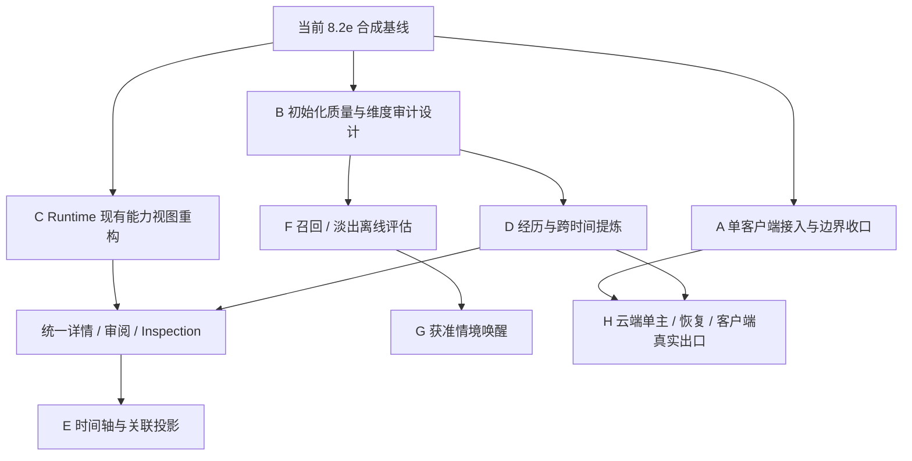

# 前后端开发路线提案

> 历史材料（2026-10-24，2026-11-02 补入版本管理）。实现状态、暂停与授权只描述原日期；当前事实以主线实现、分阶段计划及最新验证报告为准。本文不启动任何工作。

日期：2026-10-24。状态：供 Morii 选择实施顺序，**不是新 MV 阶段的启动授权**。当前正式阶段、历史授权和出口仍以 [IMPLEMENTATION_PLAN](../IMPLEMENTATION_PLAN.md)、ADRs 与对应 validation 为准。这里的 A～H 是讨论用工作包，不替代 MV 编号，也不声明已经领取。

**最新目标与优先级以 [06 全自动路线](06-automation-and-ombre-migration.md) 为准。** Morii 已确认不承担日常逐条审核；本页先建设人工审阅闭环、让 Morii 消化候选等旧产品建议不再适用。新首要闭环是可靠捕获、自动提炼/准入和下次自动使用，UI 以观察与可选纠正为主。当前代码仍依赖 owner 的事实不变，实施时需正式修改契约，不能伪造人工确认。

具体执行顺序现以 [07 核心重构与 Runtime 路线](07-core-refactor-and-runtime-route.md) 为准，MCP 新增工作暂缓；本页 A～H 保留作较早的范围讨论，不是下一轮 Session 的领取清单。

## 1. 为什么调整重点

继续只完善接入和存储，会让系统更安全地保存少量扁平信息，却不能回答 Morii 最在意的“经历如何变成可用记忆”。反过来，整体迁入某个开源记忆应用，又会丢掉已经建立的审核、来源、时间、权限、单主和恢复语义。建议保留底座，下一轮把质量和可理解性放到同等位置。

最接近价值的闭环是：主人看见一组有来源的经历与候选，修正系统的理解；随后问到相关问题，能看见正确记忆被选中以及为什么；新证据出现后能保留过去并纠正现在。时间轴、星图和模拟器帮助完成这个闭环，不能单独作为“记忆变聪明”的验收。

## 2. 与现有 MV 路线的关系

| 正式路线 | 当前证据边界 | 本提案如何接入 |
|---|---|---|
| MV-1～6 本地基础 | 已有大量合成/历史验收；实际 Runtime/当前版本验收分别核实 | 不重写底层；按现有 IPC 做可用性改进，补必要 UI 证据 |
| MV-7 / H1～H2 | Provider 功能、历史任务/审核/质量工具已有代码；真实双 Provider/个人质量不能由合成证明 | B/C/D 先明确质量缺口，用既有质量工具与合成材料准备补全 |
| MV-8 Host/MCP | 当前 HEAD 到 8.2e 的受限同 Host 六工具；真实外部 Agent 认证接线仍待做 | A 完成被选定的单客户端闭环；不把协议完成写成日用完成 |
| MV-9 云端主库 | 是 ADR-MEM-49 的目标路线，尚非本轮部署任务 | H 保留平台/恢复/迁主门槛；不因重视认知就建立第二主库 |
| MV-10 副本/离线 | 必须服从单主、删除与撤回 | 移动端先设计/只读；实际同步和离线写另走正式阶段 |
| MV-11 可选语义检索/维护 | 需要与基线比较后证明增益 | E/F 的离线研究适合成为首批候选；是否提前到 MV-9 前实施，待 Morii 决定 |

现有 8.2e 交付保留，其阶段记录要求完成后停止；A 的更广外部接线仍需主人另行领取。建议将后续明确选定的 A 与前端重构中已经授权的设计/现有 API 展示并行。B 的真实样本、D/E/F 的新实现和 H 的云端也需分别领取，不能由本次研究自动启动。前端不必等待云端才能改好，但不能伪造尚不存在的后端能力。

图表示技术依赖，不表示所有节点已获实施授权。E 的界面可先用明确标注的合成 fixture；真实只读投影在契约落地后接线。H 需要自己的完整出口，不能只由 A/D 完成推导。

## 3. 工作包与可交付出口

### A. 当前 Host/MCP 的单客户端闭环

目的：让一个明确选择的客户端，在自己的主体/权限内完成“查找 → 阅读 → 使用上下文 → 提议 → 主人审核 → 下一轮使用”，并保留 checkpoint 的 provisional 身份。

后端：继续当前 MV-8 的既有契约，设计/验证外部 Agent 原生登记与撤回、stdio 启动与信任边界、范围和目的地、请求键与未知结果处理。不向 MCP 开放 owner 审核、导入、Identity、删除或任意 Workspace 调用。

前端：Runtime 显示连接对象、主体、范围、连接/撤回状态与结果未知，不能把 page claims 当授权。Claude 先在正在重构的实际 checkout 核实 pin；本次可读旧 Runtime 副本不能代表那边最新工作。

出口：一个具名客户端/版本的接入记录；分范围读写与撤回、重启/断连/结果未知的明确证据；候选待审和正式记忆不混淆。真实客户端和私人数据是独立激活点，先用合成库。不得因为端到端演示成功就宣称所有客户端兼容。

### B. 初始化质量与维度覆盖

目的：先知道缺了哪些内容和维度，避免对整个私人库重跑模型后制造更大候选堆积。

后端/研究：复用历史规划、任务、topic brief、quality bundle、人工评估工具。先在合成材料建立事件/条件偏好/取消/关系归属/未竟事项等案例；设计真实抽样说明和覆盖表。维度缺失与事实不存在分开，原件保全、解析、抽取、候选、审核、召回质量各有计数和未知项。

前端：三栏审阅显示原文及上下文、当前候选、相近/冲突记录；来源角色、时间不确定、缺附件、候选状态要可见。优先解决审核负担，不能默认全选接受或把进度条作为语义质量。

出口：合成评审材料、漏提/错提/主体/时效/维度清单、初始质量基线及待主人选择的真实小样本方案。没有真实审查就不填真实通过率。详细流程见 [评估与补全](04-evaluation-and-backfill.md)。

### C. Runtime 现有能力的界面重构

目的：在后端不变时，让已有记忆、候选、来源、会话与 Inspection 更容易理解和操作。

前端：统一页面层级与详情抽屉；记忆格/列表、明确的状态和筛选、候选审阅差异、来源定位、有效时间、旧事实/当前事实及 Context 原因。保持键盘、读取顺序、焦点恢复、错误恢复、过期结果和幂等行为；新样式不绕过原保护逻辑。

后端：本包不增加实现。需要新分页/聚合/只读视图时，先在契约准备度表标缺口，后续冻结合适契约。不得前端全量下载敏感库再过滤。

出口：Claude 在实际 Runtime checkout 内的变更和合成渲染证据；实际采用 pin、已实现页面、占位/fixture 页面分别记录。交接包及可复制提示词见 [前端交接](../../handoff/memory-ui-2026-10-24/README.md)。

### D. 多维经历与跨时间提炼

目的：让初始化和日常提议从 fact/preference 为主，走向忠实的 episode、project_state 及相互变化；不是先添加抽象图数据库。

先做当前类型已能承载的部分：主体/项目的明确关联、事件区间与精度、条件和否定、计划/决定/实现区别、open loops、替代与冲突建议。审核精确版本，模型输出继续是候选。涉及新类型/关系边、感受来源、投影依赖等未覆盖语义，先独立 ADR/Schema 提案和负例，审定后再写实现。

输入选择、来源修订、分析上下文依赖、输出版本、预算和模型版本需能对账。新增 extractor/prompt 只能产生新版本候选提案，不静默修改旧候选或已经批准的 Canonical。没有来源支撑的精彩故事属于不合格输出。

出口：同一组合成材料上的前后对比、关键单元覆盖、主体/条件/时效错误、人工修改负担、预算、重试/去重和删除传播证据。真实模型质量另测，结构校验不能替代语义判断。

建议把 D 拆成可以独立审查的三片，不同时做完所有“认知能力”：

| 建议切片 | 只解决什么 | 此片不承担什么 |
|---|---|---|
| D1：有证据的 episode 候选 | 在既有五类型中补一个高价值入口，保留事件区间/精度、参与者、来源、摘要；先对照合成经历的错提和漏提 | 不做全库自动事件合并、关系图、感受分数或自动接受 |
| D2：项目/意向的变化 | 区分计划、决定、已发生、暂停、取消与未竟事项；生成带来源的比较与待审更新 | 不将“老了/未访问”改成完成，不启动提醒调度 |
| D3：主题与主观理解 | 对已选事件形成可追溯的主题导航/作者注释；事实、本人表达、Enouia 解释分别展示 | 不从重复模型总结晋升人格/关系事实，不引入黑箱的永久认识层 |

D1 先核查现有 EpisodeFields 与治理 details 是否足够，再冻结抽取响应和输入证据规则；不能因为 Canonical 已有 episode 类型就假定 extractor 和 Workspace 编辑接口已经支持。前端可以先在统一详情展示后端真实返回的 episode，完整事件轴另由 E 的分页/授权投影承担。每片是否进入 MV-7 质量续作或其他正式编号，由领取时的 ADR 明确，不在这里自封阶段。

### E. 时间轴与可解释关联

目的：给多维记忆一个能检查、追溯和纠正的空间。

时间轴先做事实发生时间与记录时间的选择、未知/区间时间、日/月缩放、并行主题轨道、证据密度与来源跳转。计划、事件、状态区间与复核到期须有不同视觉语义；不能把一条跨月关系线解释成每天都有证据。

星图先做有界、带类型的关系：共享主题/项目、同一明确事件、支持证据、替代/冲突、主人确认关系。共同标签或相似文本只叫“关联线索”，默认不成为 Canonical 实体关系。节点、边、聚合名、计数先按主体权限过滤；旧投影随删除/撤回失效。没有事件关系契约时只出合成设计，不能把浏览器推断连线写回正式记忆。

出口：同一记忆在格/轴/图的身份、版本和来源一致；时间未知不编造；空图/弱关联和大数据降级可用；键盘列表替代图；删除/撤回后派生展示与缓存不泄露。只读投影实现也要遵守 Vault 快照/屏障，不直接爬真实文件。

### F. 可解释召回、反馈与自然淡出实验

目的：用固定问题证明回忆更准确，减少无关私人内容和过时内容。

保留当前 baseline，按 [生命周期设计](02-lifecycle-design.md) 比较范围/别名/时间线索、可选语义召回与多样性。情绪和重要性不直接照搬第三方数值，搜索不自动强化。淡出只影响普通召回，保护记忆、历史问题、权限与删除不可被分数覆盖。

模拟器第一版只使用合成数据或浏览已有 Inspection；真实库的无写 dry-run 端口需要单独冻结。本地参数滑块只影响当前实验，不能“修改即时生效”地改变生产配置。若后续开放策略编辑，先比较草案/当前值，限定生效范围，版本化、可回滚并有明确提交。

出口：错误分类、前后对照及消融；不相关暴露、过时回答、错误确定性和删除回归不增加；显示未改善的题目。达到何种效果可启用属于主人决定。没有足够增益就保留简单基线，不引入向量/图依赖。

### G. 情境唤醒与回顾

目的：在主人希望的时机提出恰当记忆，不变成持续打扰或监视。

先让用户主动选择项目续接和时间范围回顾；再考虑明确 opt-in 的日期/事件规则。调度条件、时区、冷却、quiet hours、单次/重复、取消、离线积压与发送前屏障都有可解释状态。不依赖 Activity，不把感受推断作为通知触发，不自动执行记忆中的行动。

出口：无授权/已取消绝不投递；同一事件不刷屏；时区、时钟变化、过期、撤回和敏感内容的合成场景完整；用户能检查“为何此刻想起”，能一键停止对应规则。真实通知与长期背景运行另验收。

### H. 继续云端单主与恢复路线

目的仍是“电脑关闭期间，获准客户端可访问同一权威记忆”，不新增独立的第二套云记忆产品。

保留 Linux/平台端口、文件持久性与密钥、备份/独立恢复、scope/认证、删除水位、primary_epoch、旧主栅栏、连续运行与受控迁主等门槛。C～G 的投影、索引、规则和反馈也需定义重建/迁移/删除关系，不能成为不受单主管理的旁库。移动端先采用同样的只读视图与候选语义，离线接受与同步在 MV-10 再定。

出口：按现有 MV-9/MV-10 逐项验证；本包不申请 VPS、部署、读取真实凭据、切换主库或声称已经可以关机后持续访问。

## 4. 共同实施规则

1. 每包先列实际 owned files，保留并行 UI 与主人修改；不重置/清理未知改动。
2. 新安全/持久化语义先冻结合适契约，不能拿本文概念表充当现成 Schema。
3. Memory Core 保持独立；不依赖 Runtime checkout、Activity、第三方项目源码目录或其构建产物。
4. 产品 UI 在 Runtime。更改 Memory 集成面时，在**同一实现提交**更新 Runtime surface 与采用说明；本轮纯研究没有改变集成面，未运行生成器。
5. 验证与改动风险相称：文本改动查文档；局部行为用 focused tests；真正跨域、依赖/工具链或 release 才扩展到全仓。第三方测试数量与历史报告不能替代自己的验证。
6. 结构有效、合成通过、真实模型质量、客户端兼容、个人接受和生产运行分开记录，不给一个“完成百分比”掩盖这些差别。
7. 第三方材料先核许可与来源；搬代码时保留原许可/署名并检查依赖。截图里的产品故事和私人内容不能用作测试数据。

## 5. 最值得主人决定的三项

| 优先级 | 建议决定 | 推荐选项及原因 |
|---|---|---|
| P0 | 下一轮认知工作从哪里开始？ | 先 B 的合成质量基线 + C 的现有能力 UI，随后领取 D；先解决“理解了什么” |
| P1 | 是否将 MV-11 的首个离线检索/淡出实验提前？ | 在 MV-8 合成接入收口后、MV-9 真实迁主前做一个有界 F；不同时启动完整语义/图谱系统 |
| P2 | 第一版界面与参考复用范围？ | 采用记忆格 + 审阅 + 统一详情 + 时间线基础，星图/模拟器先合成设计；借鉴 folio 交互，核心逻辑保留 Enouia 治理 |

这些推荐不要求 Morii 现在回复，也不阻止本包一次完成。实际编码前由主人选择领取哪包；首个真实 MCP 客户端、真实样本、Provider 预算、备份位置和云端资源在各自激活点另定，不由研究者代填。
