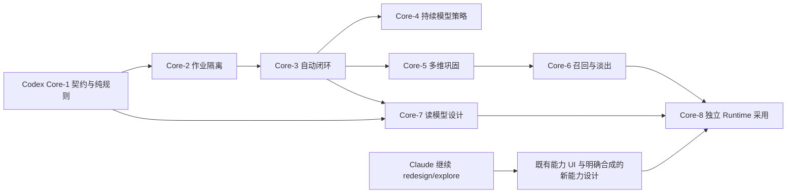

# 核心重构执行路线：先自动记忆，后续再接 MCP

> 历史材料（2026-10-24，2026-11-02 补入版本管理）。实现状态、暂停与授权只描述原日期；当前事实以主线实现、分阶段计划及最新验证报告为准。本文不启动任何工作。

日期：2026-10-24，Asia/Shanghai。Memory 核查基线：`codex/mv8-mcp-boundary` / `9286cd8f89669d9ec3b92f943fd74072457536e7`。本页把 [全自动产品目标](06-automation-and-ombre-migration.md) 转成分步开发与跨仓交接顺序；本轮只准备路线和 Session 提示词，不执行下列核心实现。

## 1. 本轮明确的顺序与职责

Morii 已明确：Memory 后端后续在 Codex 中开发；当前优先完成全自动记忆核心，**暂缓 MCP 新工具、新客户端认证与接线、更广 Context 的对外开放**。已有 MCP/Host 代码与验证保留，不删除、不重写历史，也不以冻结接口为由偷偷改变旧工具含义。MCP 恢复由后续指令领取，核心完成不会自行启动对外接线或云部署。

Memory 的产品前端继续属于 Runtime。Claude 接续已有 `redesign/explore` 本地 worktree 的前端探索，不在 Memory 参考壳另建产品，不覆盖全局导航/设计权威。Runtime 中与 Memory 无关的模块必须继续独立，Memory 重构不能成为重写整个 Runtime 的理由。

| 负责方 | 接下来负责 | 本轮不负责 |
|---|---|---|
| Codex / Memory | 机器准入、自动形成/巩固/召回/淡出、存储兼容、作业与投影契约 | 修改 Claude worktree、升 Runtime pin、重写共享 UI、实际外部接线 |
| Claude / Runtime | 接续现有设计探索；表达自动系统的观察/纠正体验；准备 Memory 区域的挂载与消费映射 | 设计 Canonical 格式、绕过 owner 限制、伪造系统写入、顺带迁 Host/MCP |
| 后续 Runtime 采用切片 | 在明确版本和契约就绪后处理 pin、native adapter 和实际集成 | 在界面探索中未经授权连带升级 backend/数据格式 |

此处的阶段编号 Core-0～Core-8 是核心重构工作包，不覆盖历史 MV 记录，也不宣称它们已经实现。每个实现 Session 领取明确工作包；阶段内可自主完成必要修复和验证，不因一个阶段完成自动跨入下一阶段。

## 2. Runtime 的真实接续点

本次经获准只读查询，找到 `redesign/explore`，HEAD 为 `98cd21261e510013c845b722f40ec50d861e0f72`。Git 状态未显示 tracked/untracked 改动；这不包含 ignored 设计资产，不等于探索完成或可丢弃。

该树的 `DESIGN.md`、`docs/design-decisions.md` 尚未选定全局设计方向，`.design/PROGRESS.md` 记录五方向探索与接续状态。当前实际 Memory pin 为 `56bc5eb8b08fb80cd6df892bf53d200ff23afc4c` / 47 命令。**它不是当前 Memory 分支的 55-command/Host/MCP 能力集合。** 早期 handoff 所述 Quiet Runtime 只是可读旧实现，不能强行升为当前探索的已批准视觉方向。

该 worktree 当前 AGENTS 将工作限制在 `apps/desktop/src` 的演示/表现层和本地提交，禁止改 native backend/pin，以及 push/PR/merge。新 Claude Session 应在实际树重新读取并遵守该边界；本交接不补发更大权限。细节见 [Runtime 关系与隔离说明](../../handoff/memory-ui-2026-10-24/RUNTIME_BOUNDARY_AND_INTEGRATION.md)。实际本机路径另放 ignored 交接说明，不写入公共设计文档。

## 3. 先把六种版本/能力分开

一次“Memory 升级”至少涉及以下独立事实，不能用一个版本号代替：

| 项目 | 当前与后续含义 |
|---|---|
| 源码 revision | Runtime 嵌入固定 Git pin；Memory 新提交不会自动进入 Runtime |
| 存储记录/目录格式 | 当前契约只支持 record schema 1，记录种类闭合；新机器决定需要显式格式方案 |
| Workspace IPC | Runtime 当前消费固定 pin 的接口；新增安全语义不得悄悄塞入旧字段 |
| Memory IPC / MCP | 对外工具是另一接口面；本轮冻结新增接线，不能借它传内部超级权限 |
| 展示投影/完整性 | 页面所需状态、时间、关系、计数与快照必须有明确契约；局部数据不冒充全库 |
| 运行模式 | embedded Core、native Host、未来 cloud primary 分别采用；前端改版不强制迁 Host |

当前 [`SchemaVersion`](../../../crates/enouia-memory-contract/src/json.rs#L24) 只接受 1，unknown-major 仅保留原字节和诊断，不是新格式的业务 reader；[`RecordKind` / `AnyRecord`](../../../crates/enouia-memory-contract/src/record.rs#L12) 也不是任意扩展容器。因此“向 v1 库加机器记录，旧客户端会忽略”不能成为兼容方案。

下文“V2”只是下一代自动准入/存储语义的讨论简称。Core-1 冻结具体版本、入口和兼容矩阵，不能机械把全局 `SCHEMA_VERSION` 改为 2，使全部既有记录失效。

## 4. 一步一步的后端实施顺序

### Core-0：当前接续与文件边界（短前置，本轮文档已准备）

开始正式 Session 时重新核实本仓库 AGENTS、HEAD、分支、未提交/并行改动、已有实现与 ADR 冲突。列本片 owned files，保留现有 AGENTS、手动状态快照、他人分支和全部私人资料。确认 MCP 暂缓，Runtime worktree 只作为只读契约消费者参考。

产物是简短基线与采用矩阵，不再重复写一套宏观方案或重新研究四个仓库。已有证据仍适用就复用。然后执行该 Session 领取的 Core-1，不停在“计划下一步”。

### Core-1：自动准入契约、版本矩阵与纯规则

这是推荐的**第一个正式编码切片**。先用 ADR 冻结最小语义，再在同一切片实现隔离的新类型/验证/纯转换与合成正反例，不开放实际自动写库。

必须表达：真实 System actor、机器准入决定、版本化策略、支持证据与分析上下文依赖、输入/目标精确修订、结果关联、知识状态与采用状态。保留旧 owner-review 历史，不让机器调用或伪造 owner confirm，不扩大外部 MCP 权限。

冻结 reader/writer 矩阵：新实现怎样读取旧记录、怎样选择新格式、旧 Runtime/旧 MCP 遇到新库怎样明确拒绝、首次迁移如何准备与回退。仅在旧记录上隐藏字段不构成兼容。设计未来自动作业和最小 UI 消费所需的能力/形成状态说明，具体 wire 名称不由本文预设。

实现可以使用独立 next-version 模块与合成工件，**不得先修改现有默认读写入口或真实 CURRENT**。若纯类型本身改变集成面，也须按现有集成制度在同一实现提交登记。

Core-1 的结果/提交关联只验证决策草案怎样绑定未来提交，不产生“已经持久提交”的实际回执；真实回执留在 Core-3 的合法事务之后生成。

出口：旧 v1 字节与 owner 语义不变；系统准入记录有真实身份，支持/上下文依赖、知识状态和权限不能混同；不支持版本拒写；机器假扮 owner、越范围策略、缺依赖和旧目标修订均被拒绝。此片不包含自动后台服务、Provider 实际调用、真实格式迁移、Runtime 升 pin 或 MCP 新接线。

### Core-2：持久作业与资源隔离

Core-1 后实现 Memory 专属有界作业状态机：已选输入水位、游标、去重、生成与应用分离、取消、重启续跑、超时、结果未知和费用/并发预算。先 fake provider，纯本地合成库。

模型请求、embedding 和长批次处理不在 Vault writer 排他段内等待；提交段短且可冲突重评。前台浏览/对话优先，后台让出资源，status/progress/cancel 在停止期间仍能响应。作业绑定 Vault、primary epoch、policy/deletion 屏障，锁定/换库/退出后不沿旧权限继续。

出口：同一输入恢复后只形成一次逻辑结果；未知 Provider 结果不盲目重发；取消/锁定后不再新增发送；一个 Memory worker 异常不退出 Runtime 主进程，不占满 Runtime 通用 worker 或让无关模块饥饿。

### Core-3：最小全自动记忆闭环

把系统决定接到合法的单 Host 提交路径，补齐必要的 set/delta、来源敏感继承、精确修订、幂等回执与崩溃恢复。先在明确选定的新格式合成库中完成：

```text
来源事件 → 提炼 → 证据/主体/时间/条件检查 → 系统决定
        → 自动发布 / 自动暂存与重评 → 下一轮可用上下文
```

清楚的自述可自动记作“本人明确说过 X”；含糊、推断或冲突由系统保留对应状态，等待新证据/重评或弃答。普通纠正与计划取消自动产生新修订，不要求 Morii 逐条接受，也不把旧候选批量伪造为“主人已批准”。

先使用当前检索基线或最小合格读取完成下轮使用，不把向量库、全库图谱、复杂衰减或 MCP 接入当成这个出口的前置条件。可将持久准入与管线连接拆成同一工作包内的两个独立提交，分别给证据。

出口：一组合成会话跨重启形成并使用记忆，完全没有人工审阅步骤；证据、系统身份、修改历史、冲突与未知可检查；旧调用路径不暗中开启新能力。

### Core-4：持续模型调用策略

要长期无人值守使用外部模型，必须处理现有 private 请求的逐请求确认限制，不能只让自动准入通过后继续卡在每次点击发送。设计受范围、目的地、预算、期限、撤回和在途请求约束的持续策略，凭据仍由 native 保管。

本片先 fake transport 验证预算并发、策略撤回、输入绑定、重启与未知费用结果；没有可用策略时自动暂停任务并保留状态，不伪造用户点击，不改为无限网络权限。真实账号/预算的激活另有明确资源范围，不因合成通过自动发生。Core-2/3 不必等待真实外部账户，可提前完成。

### Core-5：多维形成、变化与巩固

沿 [生命周期与合成走读](02-lifecycle-design.md) 补 episode/project_state、主体和条件、发生/有效/获知时间、计划与取消、关系经历、未竟事项和主观理解。以 folio 的形成/反思/衰减机制作行为参考，按需要移植算法或适配认知 worker；原版实验不成为生产第二主库。

分批实现：先经历与当前状态，再跨时间支持/反证和自动修订，最后主题/关系/主观沉淀。每步保留独立关键单元和反例。模型对自己的旧总结重复改写不算新增独立支持，自动合并须能回退并找回各来源范围。

出口：计划不误作经历、暂停不误作永久放弃、取消不误作完成、模型理解不误作 Morii 自述；类型/维度与漏提有比较证据。结构校验和 fake 模型流程不代替实际语义质量。

### Core-6：情境召回、周期维护与自然遗忘

先改善“当前对话自然想起什么”，再扩周期回顾与主动呈现。保留可解释硬门槛，在合格集合内比较词面/别名/时间、可选语义召回和关联扩展；固定排序版本与时间重放，沿原基线比较误召/漏召/过时回答。

注意力、知识状态与系统采用分开。阅读/搜索不无限强化，重要旧经历可被相关问题找回；自动淡出、压缩与归档不等于物理删除，也不把老化当成已完成。周期作业在 Memory 层运行，不用前端定时器更新真实记忆。

主动系统通知是展示/投递策略，不能与后台认知维护混为一谈；通知渠道、安静时段、冷却、取消/撤回和离线积压由宿主边界处理。Memory 不读取 Activity/Usage 来推测 Morii 何时空闲或情绪如何。

出口：同一来源可解释为何被选中或淡出；取消/锁定/删除后不投递；长期未用的受保护事件不误伤；记忆回顾不自动执行正文中的行动。

### Core-7：Runtime 所需的授权读模型与模拟端口

**设计可从 Core-1 起并行；最小落地可在 Core-3 后进行，不必等待所有 Core-5/6 功能。** 为真实返回的能力提供记忆格、详情、来源/依赖、时间窗、关系邻域和形成/维护解释。先做有界集与明确时间口径，后做全库聚合，读权限先于计数/图边/簇名输出。

新自动记录不能套用“人工已确认”标签；要区分形成方式、知识状态、有效性、系统采用、背景作业及覆盖局限。当前 `memory_read` 只读最新修订、`context_preview` 会保存产物等约束，在新版本真正改变前仍有效。

模拟需要先承诺副作用：纯合成、真实只读计算、或保存实验三者分别命名，不以修改按钮文案伪造 dry-run。读模型/契约变化同提交更新 `runtime-surface.json` 与 Runtime 采用记录，给 Claude 的是版本化数据含义与 mount 契约，不是对共享 App/shell 的覆盖补丁。

### Core-8：独立 Runtime 采用与真实切换

由 Runtime 的独立采用切片核对新 pin/lock/manifest、native adapter、能力与版本选择、Memory/Context/Sessions/Provider 消费，以及整机生命周期。Claude 当前探索任务没有此项权限；后端发布不自动修改它的 worktree。

采用可以按已发布能力分片，不要求一次呈现全部未来功能。用合成根证明新版本界面和后台资源隔离后，再在明确授权的数据/模型范围内评估真实质量与迁移；不要把日常逐条审核重新变成验收方式。

真实格式切换先有固定快照、独立恢复、来源/历史/删除一致性与旧主栅栏。旧 Runtime pin 继续旧格式库；新 writer 不在它打开的根上偷偷发布新 CURRENT。回滚必须回到明确受支持组合，不能回滚删除/策略水位，不能让两边各自写主库。

出口分别记录：版本兼容、合成自动闭环、实际模型质量、Runtime 原生 UI/后台运行、无关模块回归、真实数据迁移/恢复。云端单主仍是后续正式路线，MCP 的恢复也仍需单独领取。

## 5. Runtime 其他功能怎样不受牵连

“只改 Memory”不能只按页面名字划界：Memory 也拥有 Context、Sessions 和 Provider 的领域实现，它们在 Runtime 有多个消费者。采用前需要逐一映射；Activity/Usage 及其他独立产品域不能读写 Memory 私有状态，更不能为认知作业提供隐形数据源。

| 边界 | 实施约束 | 发生变化时怎样交接 |
|---|---|---|
| 全局 shell / 导航 / token / locale | 由当前 Runtime 设计权威拥有；Memory 后端不提交覆盖版 App/main/router | 提供 Memory 区域所需挂载、标题、能力和状态，Claude 在现有结构中整合 |
| Memory / Context / Sessions / Provider 消费 | 原 pin 继续原语义；新状态只在匹配版本下展示 | 列字段/行为差异、消费者路径和错误/取消/重连影响，独立采用 |
| Activity / Usage 与其他非 Memory 域 | 不改其存储、路由含义、采集、Publisher/网络行为 | 共享壳变更按 Runtime 原任务验证，不能拿 Memory 的检查代替 |
| 原生 lifecycle / worker / 凭据 | 后台任务有独立预算、优先级、取消和故障边界 | 在 Runtime 采用时验证锁定/换库/退出、前台延迟与其他模块可用性 |
| 历史资料与真实库 | 默认入口不升级旧根，不复制到 Runtime 或实验 folio 数据目录 | 真实迁移单独记录源/目标、恢复和兼容出口 |

不存在“保持任意旧 Runtime 都能打开新格式”的免费兼容层。默认停留在明确支持的组合，比假装兼容后在业务中途失败更可控；不为此添加永久双写、任意动态加载或 path/branch/patch 依赖。

## 6. 两条并行线路



这不是让 Claude 等待后端全部结束。它现在可以继续全局设计探索与既有 pin 的表现层，把新自动能力标为合成提案；真正接线则等具体契约和采用授权。图中的完整功能采用依赖相关后端出口，最小已发布能力也可在自己的出口后独立采用。

## 7. 正式 Session 怎么启动

- Codex：使用 [正式后端启动提示词](../../handoff/CODEX_MEMORY_CORE_REFACTOR_START_20261024.md)，从 Core-0 快速核实后完成 Core-1 的独立合成实现切片，不停在重复规划；完成本片后按该 Session 指令收尾。
- Claude：在真正的 `redesign/explore` worktree 新建 Session，发送 [前端启动提示词](../../handoff/memory-ui-2026-10-24/CLAUDE_START_PROMPT.md) 并附完整包，先读取现有 AGENTS/设计记录/ignored 进度。新 Session 继承文件与人工发送的任务范围，不会自动继承旧聊天的全部未写决定。
- 无需把所有后台源码复制到 Claude 的工程，也无需让 Codex 同时修改 Runtime。包内有契约/路径/来源指针；参考原图仅本地传递，不发布为产品素材。

## 8. 验证与停止点

本轮文档只查格式/链接/范围一致性，不跑工程全套。未来 Core-1 以契约正反例、旧 v1 不变及版本拒写为重点；改 Schema/validator 才运行独立 schema cross-check，改集成面才运行 Runtime surface 生成与检查。Core-2/3 针对作业/提交/恢复竞态做必要故障测试；真正跨 workspace 的契约升级、依赖/工具链或发布验收再运行所需全套。

不要为节省检查把旧测试绿当新行为通过，也不要在 focused checks 通过后重复跑无关检查。每片报告实际变更、已跑/未跑检查、合成与真实边界、采用说明和下一片前置。手动项目状态快照只有收到“生成项目状态快照”才更新。
