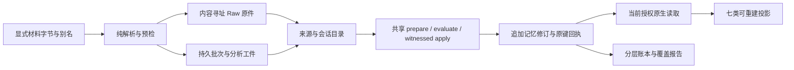

# 记忆库初始化：合成管线与覆盖报告

日期：2026-10-29。范围：新建临时合成根；真实模型调用 0，真实来源处理 0。
本片完成原生合成初始化流程，**尚未达到 Runtime 六视图完整验收**。
Runtime 交接包 02 是前端数据需求；本仓库以 Morii 已明确确认的
[ADR93](../adr/093-ui-v2-record-layout.md)为字段契约，以
[ADR104](../adr/104-synthetic-initialization-intake.md)记录本片选择与限制。

## 基线、职责和边界

从当时最新 main `c9bf1be` 建独立 `codex/memory-init-pipeline` 工作树，
随后复用字段/读取依赖分支至 `6ca8fcc`：ADR93、ADR94、ADR100、ADR101。
这些依赖提交保留原作者，本片增量独立提交。ADR93 在开工核对时位于
PR #56、提交 `24a03e0`，尚未合并；Morii 已在本会话明确确认实施。
共享来源入口的最小文件交集亦已明确授权；没有修改其他会话工作树。

2026-10-29 在同一分支整合 MCP Owner-boundary 精确提交
`14125f5cae8df2277d16c167a165b7eae3c1974c`，包含 Owner
`34709b9d2abcb60188c0e3488b15f40c33d6ee16`。初始化仅创建
`automation-segmented-owner-v1` 新根，明确绑定主人主体、创世描述符哈希和
初始化日志；不转换旧合成根。后续 MCP 原生 Agent 读取片未在本片采用。

负责文件：`crates/enouia-memory-init/**`、`Cargo.toml`/`Cargo.lock`；
共享集成是 contract 的 `next/storage.rs`/`storage_rules.rs`、storage schema，
vault 的 `automation/mod.rs`、`automation/segmented/{mod,state,intake}.rs`，
以及 Host 测试构造器补字段、故障注入夹具的目录唯一性和失败诊断。合成夹具位于
`tests/fixtures/initialization/`、`tests/fixtures/ui-records/`；文档增量为
ADR104/索引、实施计划、Runtime 面清单与采用日志、本报告及 crate README。
Owner 兼容增量还为依赖新增的 `segmented/{owner,runtime_capture}.rs` 构造器
补齐空 attachments 字段，保留依赖原有身份、创世、提交和 Agent/Runtime 拒绝逻辑。

没有扫描私人目录、打开私人聊天/Vault、读取 Activity、调用真实 Provider、
外发数据、部署、修改 Runtime 或升 pin。私人手工记忆不进入本报告或夹具。

## 管线结构

初始化与 live 使用同一个 `Plan`/System 形成通道。先按来源时间排序，
未知时间排在后面；每次有界调度先取 live，再取 backfill。原文精确定位后
才存引文与 Unicode scalar 字符范围；找不到即拒绝。每项脚本陈述单独形成。
不受原句支持的标题回退到原句前缀；这只是保守检查，不构成模型蕴含评估。
事件/有效时间与来源时间、收到时间、提交时间分别保存。

原件逐字节保存，包括未识别材料、旧 v1 完整 RecordSet、附件；
来源保存平台/账号别名/会话/消息/父分支/原始时钟/作者/模型/语言等。
原始扩展元数据保留在来源扩展，桶标签、情绪、保护等旧系统值不升级为事实
或新主人动作。未知作者/语言/时区保持明确未知；文档可显式提供作者、mtime、
语言，并绑定输入水位，不从宿主机推断默认时区。

完整旧 v1 快照先过 `validate_set`，仅精确原 Review 内容哈希/actor 关联
可作为历史主人确认来源，还须由原生 owner 选择入口提交。继承审核字段但
正文不匹配的修订、候选、桶全部保留为模型/Agent 来源；删除的目标和
支持/上下文依赖排除。初始化本身没有生成新的确认、纠正、保护或撤回收据。
显式 `OwnerProvided` 来源作为普通主人陈述正常形成；原聊天引文单独保留原说话人。
不是由 JSON 批准声明推断来源权限，也没有额外待审队列。真实原生选择仍须另做身份认证。

批次保存输入水位、解析版本、分析哈希、原始分析、稳定 ID、游标、请求、
响应哈希与回执。写应用意图在原生提交之前落盘；重开后不确定结果只查原键，
无回执保持未知。相同输入/mode 的不同分析拒绝，独立来源范围须有独立策略
身份，不能静默改旧批策略。Raw 校验先于来源发布，日志写失败使实例停用。

七类投影使用当前授权读取：字面/别名检索检查行、已记录主题家族、typed graph、
事件/学到/收到三轴的日/月桶、Core-6 注意力、统计/facets、见证活动流。
原生 catalog 已支持字面、profile alias 和有证据实体 alias 匹配；保存的 bundle
是检查工件，不能直接作为前端读取授权。每组带算法、版本、snapshot、scope、
删除/撤回屏障、依赖与覆盖。旧 bundle 在删除后过期，新读必须重新授权。

## 02 §9 实际数字

测量主运行：内置 S01–S32 加5条显示样本，共37条脚本标注陈述；
收到原件2个、11,673 bytes，哈希校验2/2；解析来源36，失败0，不支持0，
已知来源时钟36/36。中途执行6步后关闭/重开，再完成37个原生见证提交
（采用29、暂存8）；结果未知0。写库前的字段覆盖率已在预检中给出，
暂存8为预检估计、实际暂存亦为8；一般批次的最终准入仍由提交时原生评估决定。
这些数字仅覆盖显式选择的合成输入，平台全部历史数量未知。
合成时钟固定为 `2026-10-24T12:00:00Z`，用于可复现的收到/提交/注意力计算；
它不代表本次检查的真实墙上时间，也不构成真实来源时间或默认时区选择。

| §9 检查 | 删除前实际结果 | 补充验证与限制 |
| --- | --- | --- |
| 标题 | 37/37，100% | 不支持的新增信息标题回退测试通过 |
| 时间 precision/basis | 37/37，100% | unknown=35，94.595%；month=2（within/span 各1），5.405%；其余精度0。独立原生测试另有 instant=1；没有借消息时间补事件时间 |
| 实体 | 带实体3/37，8.108%；实体3；同名未合并3 | 包含真实/虚构同名实体；未自动合并；此比例不代表模型召回率 |
| 证据 | 37/37，100% 可解析精确引文 | 原消息 locator + scalar 范围；非精确原文预检拒绝 |
| 会话 | 37/37，100% 对话证据有轮次链接 | 独立分支测试保留共同父节点和两个分支 |
| 语言 | 37/37，100% 有字段且均为 en | 缺失输入使用 und；没有隐式语言模型 |
| 一条一陈述 | 1个含两陈述段落→2条，拆分1/1=100%，脚本样本例外0 | 独立测试另1个三时间陈述段落→3条。未做独立模型/人工语义抽查，语义质量为 null |
| 投影 | 7/7 建组并带元数据；非空主题1、记录成员2 | 删除1条后7/7重建，当前可见36；全 bundle 不含被删 ID。独立测试还验证删除非支持上下文使推导主题消失 |
| 界面 | 0/6；截图0 | Runtime 六视图采用未运行，本会话边界明确禁止改 Runtime；不能据此切真实库 |

删除后标题、时间字段、语言、精确证据、对话链接分别为36/36=100%；
unknown 时间34/36≈94.444%，month仍为2；带实体3/36≈8.333%，实体3。
补充显示样本使主根有实际月份区间、主题成员、推导边与同名实体；
这些均为独立编写的合成证据和脚本标签，模型准确率未知。

可复现入口：`cargo run -p enouia-memory-init --example synthetic_init --locked`。
每次创建新的临时根并打印位置，保留 `indexes/initialization-report.json` 及
删除前/当前两份检查 bundle。机器绝对路径只在本地输出；本报告不保存。
原始运行输出和检查日志位于本工作树忽略的 `.local/`，不提交根或回执包。

## 场景结果及证据等级

S01–S32 都有输入、期待、证据不足答案、诱人错误答案，并走过真实原生形成；
**32个脚本形成完成不等于32个场景语义验收通过**。以下列出实际覆盖面。

| 场景 | 本片实际验证 | 未验证的部分 |
| --- | --- | --- |
| S01、S02 | 主人/助手证据类别分开；条件维度保留 | query 适用范围与最终回答质量 |
| S03、S21 | 独立测试显式来源修订/替代链，原修订不覆盖 | 回忆后真实主人纠正 UI/G08 |
| S04 | 计划/取消/未实施脚本维度进入原生记录 | 提醒引擎 |
| S05 | 同名实体不自动合并，真实/虚构分开 | 模型消歧质量 |
| S06、S07 | 父分支保留；同账号重复原件/重复消息去重，跨账号不误去重 | 平台变化导出的通用修订协调 |
| S08、S24 | 事件未知保留；另测 month within/span 和 instant | 跨月轨道的实际 Runtime 画法 |
| S09、S17、S31 | 字段可表达有效期/未知；没有由年龄生成删除或结案动作 | live 复核、review_after 调度与回答 |
| S10、S19 | 来源敏感度不降级；投影复用当前授权原生读取 | 本片未新增全范围撤权/混合片段攻击矩阵，依赖既有原生契约测试 |
| S11、S32 | 删除后所有组重建与失效检查 | 主人撤回流程、capsule 发送、Runtime 多视图缓存 |
| S12、S29 | 删除支持/非支持上下文后推导主题不复活 | 向量缓存（未引入） |
| S13、S26、S30 | 引用指令不执行；Agent 声称批准不升级；推断保持暂存 | 独立模型对抗提取质量 |
| S14 | 明确报告与推断类别可保留，语气仅附注 | 心理推断的独立语义评估 |
| S15、S16、S18、S20、S25 | 字段/来源经过原生形成 | 保护召回、检索强化/误召、预算下冲突回答、语义近邻质量 |
| S22、S27 | 原键回执恢复；无回执未知不重发；重开游标 | 真实模型拒答/网络和真实 UI 连接 |
| S23、S28 | 仅保留评估输入 | 通知取消/时区改动、键盘/无障碍视图由其他切片验收 |

原有13项初始化集成测试：完整流程/修订/七投影删除、已提交未知恢复、
解析未知/拒绝、32脚本形成、live优先与无回执不重发、上下文删除推导、
Runtime/Claude/文档/桶保全、旧Review见证与伪造拒绝、附件、三种时间、
账号隔离去重、标题保守回退、显式文档元数据与算法附注。

Owner 兼容另增3项，共16项：旧/未绑定描述符在写根前拒绝，外来主体入队和
日志描述符哈希篡改拒绝，显式主人来源正常采用为一条独立记忆且初始化动作数为0。
最后一项随后通过独立模拟的原生手势计划/确认/提交保护动作，验证同一初始化根
可由 G08 使用，动作数实际变为1，v4 selection 和保护投影生效；该动作不是解析器制造。
主示例仍以37条陈述、36个来源重新跑完预检/中断/重开/形成/七投影/删除流程，
覆盖表数字保持不变，读取 selection 为 `owner-qualified-catalog-4`/v4。

## 与需求仍有差异

- G08 后端由依赖提供；本片只补同一初始化根的独立原生合成动作验证，
  不会用 System 伪造主人动作或主题标注继承，真实手势/UI 仍未验收。
- 形成输入是显式脚本分析；没有真实模型适配、模型语义提取或语义检索评估。
  已支持各项附注传递，但本例缺少的模型值保持空，不生成情绪/重要度事实。
- Claude 只覆盖观察到的合成 `uuid/chat_messages` 形状；桶当前支持 JSON，
  未支持 YAML、真实平台格式发现、二进制文档/OCR、真实 v1 快照获取。
- 同一上游消息的精确重复可去重；内容变化尚无通用来源修订协调，拒绝冲突。
  尚无生产级队列/大历史批处理性能验收。
- 已采集 Runtime 来源的精确修订仅入队 API 尚未交付，不能重包装导入以重复捕获。
  日常与初始化共用原生形成机制，不代表运行中的采集作业绑定已经完整接线。
- 每计划最多64来源/128陈述，材料与日志16 MiB，来源正文16 KiB，投影原始依赖
  上限128。超限显式拒绝，不截断原文；生产分批策略尚待实现/验收。
- Runtime 六视图采用、截图与 Core-8 新旧根切换未执行。七个数据组的检查工件
  不能替代 Runtime 的 native adapter 与当前授权读取。

## 真实资料处理前由 Morii 明确的清单

主人已经明确选入的独立条目随正常初始化直接形成，无需再次逐条批准。
以下只核对尚未明确的来源范围和处理参数，不把已有授权重置为待审。

1. 选择哪些平台/账号/会话/时间段、旧 v1 快照、桶、文档和附件；排除哪些内容，
   是否接受保留完整原件与中间分析，保留多久。应提供选择清单/别名，不自动扫盘。
2. 各类敏感度和主体/项目/访问范围；旧审核记录应由哪个原生 owner 选择并见证，
   候选/派生桶如何标识，已删除资料如何排除。
3. 使用哪个确切模型/版本、处理哪些材料、是否本地、是否允许外发到哪个目的地，
   提供方留存/日志策略、额度与失败/结果未知如何人工处置。
4. 是否允许模型/OCR读取附件原件；外部附件 URL 是否另行下载及允许目的地。
5. 默认生活时区、历史时区变化以及没有时区的来源如何解释；当前测试显式参数
   不构成真实数据默认时区授权。
6. 独立语义抽查样本与可接受漏提/误提标准；实际 Runtime 采用片怎样验证六视图，
   再由 Core-8 执行旧库只读保留和新根切换。

## 仓库检查

### 初版合成切片

初版合成切片日志以本工作树 `.local/` 为准；当时全量日志为
`workspace-tests-final-native.log`，故障夹具专项为 `host-recovery-tests.log`。

| 检查 | 结果 |
| --- | --- |
| 初始化专项 | 13 passed |
| `cargo fmt --all -- --check` | passed |
| `cargo test --workspace --locked` | 最终704 passed、0 failed、3 ignored（原有显式大规模用例） |
| `cargo clippy --workspace --all-targets --locked -- -D warnings` | passed |
| 独立 Python 3.12 / jsonschema 4.26.0 | passed；54 schemas，UI corpus 53 documents |
| Runtime surface | passed；清单已重生成并在采用日志记录 aggregate |

原生 NTFS/ACL 测试需在允许本进程检查 ACL 的环境运行；沙箱内创建根的拒绝
未通过削弱产品检查来规避。无真实资料/真实模型/Runtime 部署验收声明。

中间全量复跑曾失败：旧 Host 崩溃夹具按 PID+进程内序号建目录，子进程
故意 abort 留下目录后，Windows PID 复用会触发 `AlreadyExists`，业务代码尚未
执行便退出101，而预期故障注入退出码为3。定点通过不能解释并发失败；新增
子进程失败输出后定位至 `create_dir`，改用与现有 segmented 夹具相同的随机
UUID 新根命名。没有删旧目录、放宽断言、延长超时或修改产品恢复语义。
另一次额外重定向 TEMP/TMP 的检查出现旧 Context 用例 `NotFound`；已撤回该环境
改动，没有修改 Context 产品或测试。最终验证使用原先通过的原生环境。

2026-10-29 Owner 兼容检查先被未更新的集成清单拒绝；重生成清单并登记后，
该检查通过。默认任务并行的全量运行随后在既有 Workspace 用例
`full_session_ask_replays_a_concurrent_input_commit` 的固定200次竞争重试耗尽处
失败：另一调用约4.9秒才返回。同一个全量测试二进制单独运行该用例约0.54秒通过；
这提示整套测试的资源竞争，尚不能据此宣称已修复默认并行的不稳定性。
本片与 main 相比未修改 Workspace/索引代码、断言、重试次数或超时。
后续全量验证设置 `RUST_TEST_THREADS=4` 控制同时调度的测试任务数量，
保留用例内部的真实并发。默认并行失败日志保存在本地
`owner-workspace-tests-default-contention.log`，不以专项通过替代全量结果。

### 2026-10-29 Owner 兼容

Rust 1.98.1 / Windows GNU；Cargo 离线且 locked；TEMP/TMP 沿用原生环境。
最终全量日志为 `owner-workspace-tests-final.log`，严格 clippy 日志为
`owner-workspace-clippy-final.log`。未运行4个显式忽略用例：20,000条遍历、
5,000节点遍历、Owner 夹具生成和过程夹具生成。

| 检查 | 本次实际结果 |
| --- | --- |
| Owner 根初始化专项 | 16 passed，包括正常主人输入采用与独立 G08 合成手势 |
| 合成主示例 | 37/37形成，关闭/重开后完成；删除后36可见，7/7组重建 |
| `cargo fmt --all -- --check` | passed |
| `cargo test --workspace --locked`，`RUST_TEST_THREADS=4` | 791 passed、0 failed、4 ignored；95个测试二进制/文档测试组 |
| `cargo clippy --workspace --all-targets --locked -- -D warnings` | passed |
| 独立 Python 3.12 / jsonschema 4.26.0 | passed；60 schemas，UI corpus 53、process 102、owner 44 documents |
| Runtime surface | passed；aggregate `94b039be8c17cfcb50a85853fbd3a72894aa69650d81757aa71515505e357e06` 已重生成并登记 |

当前全量通过证据限于上述受控任务并行条件，不宣称默认高并行的不稳定性已修复。
检查和输出仅使用合成资料；没有真实 Provider、私人初始化、Runtime GUI 或切换验收。

### 2026-10-29 原生导入入口布局门槛

MCP 接口复核指出：仅限制 initializer 创建 Owner 根，没有限制分别导出的
native import API。用原件和附件均完整闭合的有效合成输入，在修复前复现了
旧 `SegmentedV1` 上的导入成功和直接 Raw 归档；缺少附件对象造成的拒绝不算版本证明。
现在4个导入专用入口在身份检查、归档、锁和记录读取之前要求 Owner 布局，
旧 runtime-only capture 也拒绝 typed 附件载体。新增回归同时验证5条拒绝路径、
快照不变且未产生任何输入/附件 Raw 对象；不迁移旧原型根，不修改 Agent/Owner 方法。
专项17项通过，原有 Owner 正向初始化、附件与恢复均保留；主示例的 §9 数字不变。

修复后独立重跑主示例：37条形成（29采用、8暂存），36来源；删除后36条可见，
七组全部重建，事件时间仍为35 unknown / 2 month。没有真实模型或真实来源。
最终全量792 passed、0 failed、4 ignored（`RUST_TEST_THREADS=4`，95组）；
fmt、严格全目标 clippy、独立60 schemas及surface检查均通过。
日志为 `import-layout-workspace-tests-final.log`、`import-layout-clippy-final.log`、
`import-layout-synthetic-final.txt`；原有默认高并行限制继续保留，不宣称已修复。
最新surface aggregate为 `4acd2529dc5be53c4aa70a5f680f4f6522ac4d73f2e2f710bfab7f099184beb7`。
